<h1 align="center"><a href="https://ecoshift-final-8dsi.vercel.app/">Try EcoShift: ecoshift-final-8dsi.vercel.app</a></h1>

<p align="center">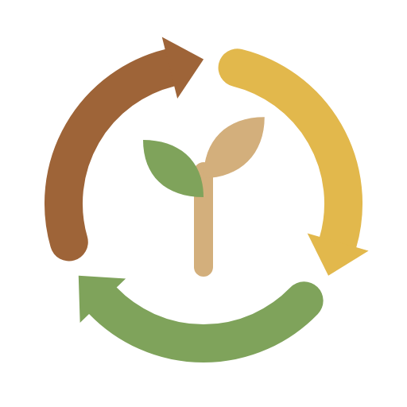</p>

<h1 align="center">EcoShift</h1>

<p align="center">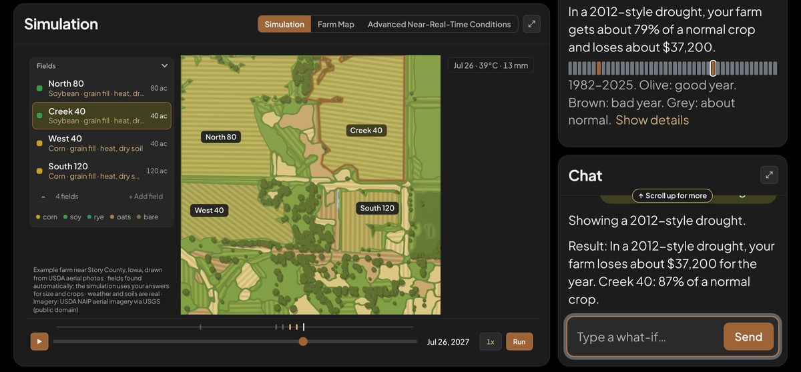</p>

**Test a crop rotation before you plant it.** EcoShift grows every rotation plan through 44 real seasons (1982 to 2025) of NASA POWER daily weather, on the farmer's own fields, with a FAO-56 soil-water crop model, then ranks the plans by harvest, profit and risk. Imported field outlines are then checked from orbit: Copernicus Sentinel-2 field health at 10 m, NASA fire detections, NASA soil wetness, terrain, ponds and live conditions.

Built for the 2026 NASA Space Apps Challenge, **"Field Shift: Adapting Farms with NASA Data"**.

| | |
|---|---|
| **Live site** | https://ecoshift-final-8dsi.vercel.app/ |
| **Challenge** | https://www.spaceappschallenge.org/2026/challenges/adapting-farms-with-nasa-data/ |
| **Validation** | [`simulator-source/VALIDATION.md`](simulator-source/VALIDATION.md) |
| **Data provenance** | [`simulator-source/DATA_NOTES.md`](simulator-source/DATA_NOTES.md) (every raw download with its URL and SHA-256) |
| **Saved evidence** | [`docs/evidence/`](docs/evidence/) (real responses from the live checks) |
| **License** | MIT |

This is a working prototype. Simulation results are estimates for comparing options, not guaranteed predictions; confirm planting decisions with local agronomic advice.

---

## Contents

1. [What It Does](#what-it-does)
2. [Try It In Two Minutes](#try-it-in-two-minutes)
3. [Architecture](#architecture)
4. [The Crop Model](#the-crop-model)
5. [How Well It Works: Validation](#how-well-it-works-validation)
6. [NASA Data](#nasa-data)
7. [Partner And Other Data](#partner-and-other-data)
8. [Your Real Fields: The Import Pipeline](#your-real-fields-the-import-pipeline)
9. [Advanced Near-Real-Time Conditions](#advanced-near-real-time-conditions)
10. [Field Health From Sentinel-2](#field-health-from-sentinel-2)
11. [The Ten Helpers: A Multi-Agent Pipeline](#the-ten-helpers-a-multi-agent-pipeline)
12. [Languages](#languages)
13. [The Farm Map](#the-farm-map)
14. [API Reference](#api-reference)
15. [Run It Locally](#run-it-locally)
16. [Configuration](#configuration)
17. [Tests](#tests)
18. [Deploying](#deploying)
19. [Repository Layout](#repository-layout)
20. [Credits And Licenses](#credits-and-licenses)

---

## What It Does

Farmers choose next year's rotation months ahead, before anyone knows the weather, and a wrong choice only shows at harvest: in the 2012 drought, Iowa's corn harvest fell to 77% of a normal year. EcoShift asks a different question than a forecast: **how would each plan have done in every one of the last 44 real seasons?**

The site has four tabs:

- **Home**: the problem, the solution, how it works in four steps, real screenshots, "NASA Data At The Core" and "Copernicus Satellites At Field Scale".
- **Project Details**: the five working parts with diagrams, the code, the data tables, the satellite check, the validation chart and the honest limits.
- **Simulation**: the simulator itself (one self-contained page, `public/deepdive/index.html`):
  1. **Farm questionnaire**: 13 short questions (location by address search or "use my location", fields, last crops, water, land, limits, money, priorities, buyers). Every question can be skipped, or the example farm loaded in one click.
  2. **Guided tutorial**: 16 steps through every part of the simulator, with large text, keyboard controls, screen-reader support and an optional read-aloud voice.
  3. **The simulation**: crop plans for each field, replayed through 44 seasons, compared in harvest and dollars; a 44-season strip; a plain-language verdict per field; a what-if chat; a 30-day outlook; field import; the farm map; Advanced Near-Real-Time Conditions with Field Health.
- **About Us**: the team, the challenge and the data credits.

On the example farm in Story County, Iowa, the current plan gets about 99% of a normal crop in a typical season (2011 weather), but about 79% in a 2012-style drought and loses about $37,200, give or take about 10 points (the model's typical error for any one season).

<table>
  <tr>
    <td width="50%"><br><b>Ask a what-if.</b> "What if 2012 happens again?" replays that drought on every field.</td>
    <td width="50%">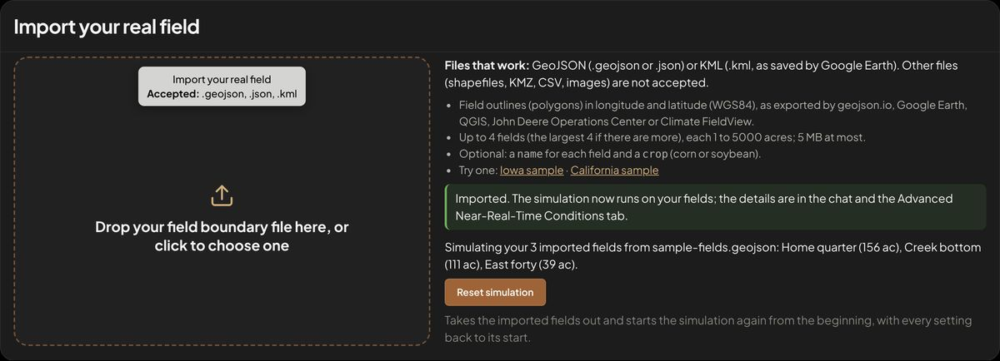<br><b>Import the field boundaries.</b> GeoJSON or KML; each field gets its own NASA POWER weather, slope and soil.</td>
  </tr>
  <tr>
    <td>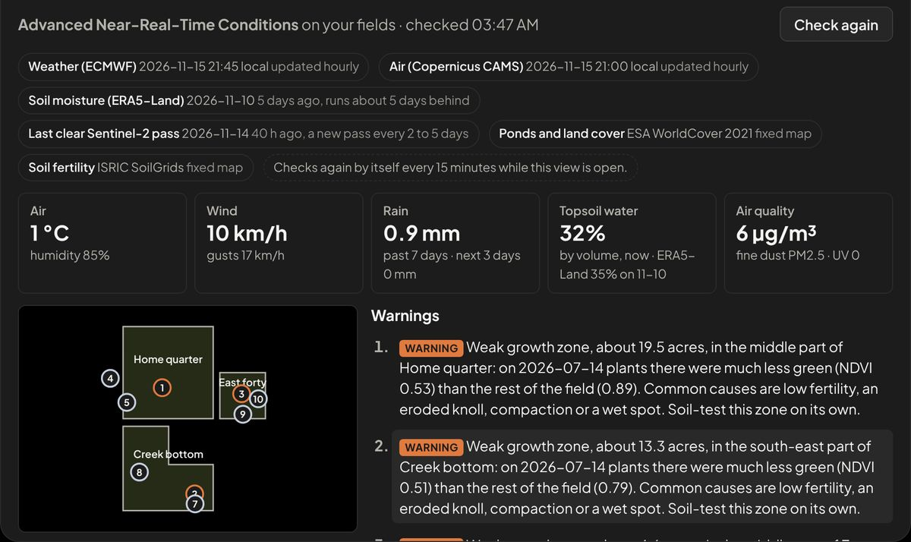<br><b>Near-real-time conditions.</b> Weather, soil, NASA fire and soil wetness, Sentinel-2 warnings pinned to the field.</td>
    <td>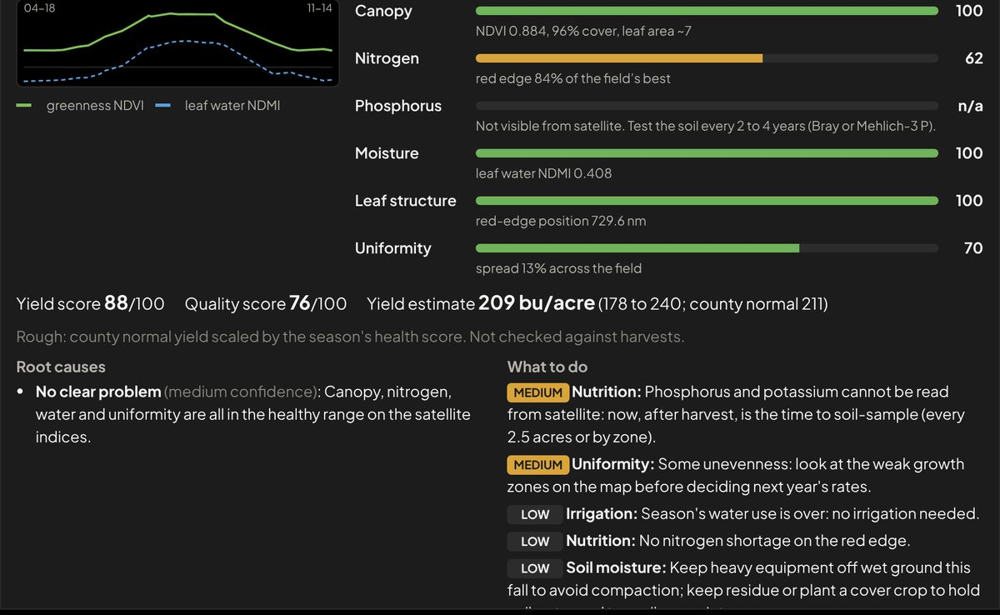<br><b>Field health from space.</b> A season of Sentinel-2 images turned into scores and advice.</td>
  </tr>
</table>

---

## Try It In Two Minutes

1. Open the [live site](https://ecoshift-final-8dsi.vercel.app/), click **Simulation**, then **Use The Example Farm**.
2. Play the season, then type **"what if 2012 happens again?"** in the chat. Under the answer, "How This Answer Was Made" lists the helpers that ran.
3. In **Import your real field** (top of the simulation), click **Iowa sample**: three real field outlines near Ames, Iowa, get their own NASA POWER weather, slope and soil.
4. Switch the view to **Advanced Near-Real-Time Conditions**: NASA fire detections, NASA soil wetness, Sentinel-2 warnings pinned to the field, then Field Health below.

---

## Architecture

One Node.js handler (`server.js`, **no npm dependencies**) serves the site and every API route. The same handler runs as `node server.js` on any host or as the single Vercel function `api/index.js`. The simulator and its crop model run entirely in the browser; the server fetches and caches public data, runs the field checks and talks to Gemini.

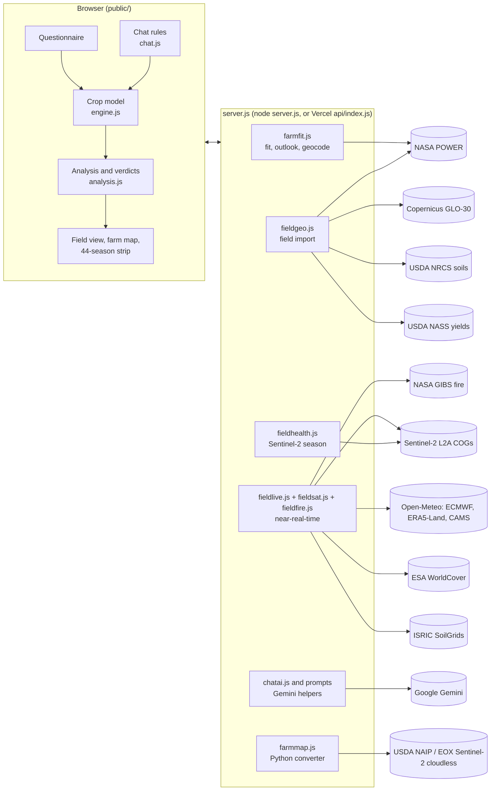

Design rules that run through the code:

- **Deterministic numbers.** Every harvest and dollar figure comes from the crop model; the AI helpers never calculate them.
- **Everything degrades gracefully.** With no AI key, no Python or a slow outside service, the rest keeps working and the page says what is missing.
- **Every constant is tagged** `SOURCED` (cited), `FITTED` (fitted to USDA yields, with the script) or `DESIGN` (a team choice to be checked).
- **Raw data is pinned.** Every download behind the built-in data is listed with its URL and SHA-256 in `simulator-source/raw/HASHES.txt`.

---

## The Crop Model

`simulator-source/src/engine.js` replays one real NASA POWER season through each field, day by day, and reports weekly. It is synchronous and makes no network calls.

**Water.** A FAO-56 daily soil-water balance over a 1.5 m profile in two layers: the root zone, which deepens as the crop grows, and the soil below the roots, which is refilled by drainage and taken into the root zone as roots reach it. Reference evapotranspiration is FAO-56 Penman-Monteith from NASA POWER temperature, dew point, wind and CERES sunlight. Crop water use is ET₀ × Kc, with Kc mid 1.20 for corn and 1.15 for soybean (FAO-56 Table 12) and the FAO-56 depletion adjustment `p = p_tab + 0.04 × (5 − ETc)`. A surface evaporation layer (REW 9 mm, TEW 25 mm, FAO-56 Table 19) decides when a field is dry enough to plant. Each season starts 75% full on 16 November; carrying the previous season's water over was tested in every fold and gave the same error.

**Growth.** Crop stages follow growing degree days (corn V6 475, R1 1420, R6 2700, from central-Iowa extension tables), with the hybrid and variety matched to the location's season length. Planting waits for a workable field: warm enough, under 5 mm of rain over two days and no hard frost. Late planting follows the Iowa State planting-date curve and needs about 6.8 fewer degree days per day of delay (Purdue).

**Yield**, as a percent of a normal crop:

```
Yield % = 100 × (Sw / median Sw)^gamma × (fill / median fill)^eDur × PD × Yf × Yrot × Ycc / norm

Sw   = Yw × Yh × Yww   water stress weighted by stage (FAO-33 Ky, corn flowering 1.50), heat, waterlogging
fill = length of grain fill; warmer seasons fill faster and shorter
PD   = planting-date multiplier (Iowa State), Yf = frost (UNL CropWatch stage losses)
Yrot = rotation effect (Iowa State budgets: corn after corn about −8%), Ycc = cereal rye before corn (ISU, −4.1%)
norm = the median season of the baseline rotation, so the median season = 100
```

The three weather exponents (`gamma`, `b`, `eDur`) are **fitted** by `tools/validate.py` with leave-one-year-out against USDA NASS Iowa yields. The heat slope `b` fits to 0: heat damage is not identifiable from the yield record, so the warming slider uses a published floor (Zhao et al. 2017, PNAS) and says so. Money comes from Iowa State University crop budgets and USDA prices; the farmer can set their own prices.

<p align="center">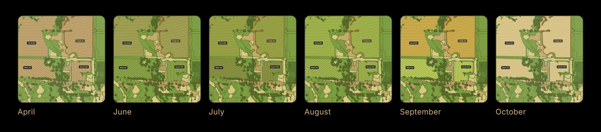<br><sub>One simulated season on the example farm: the fields are painted week by week from the model's own growth stages.</sub></p>

**What it compares.** For each field: corn, soybeans, corn after corn, soybeans after soybeans, cereal rye before corn or soybeans, and oats with a summer cover crop. Each option reports harvest and profit in a typical season and in the worst seasons, how many of the 44 seasons it beat the current plan, the evidence, the extra work and the information gaps.

---

## How Well It Works: Validation

Full method and tables: [`simulator-source/VALIDATION.md`](simulator-source/VALIDATION.md). Weather is the NASA POWER grid cell over Story County, Iowa; harvests are USDA NASS Iowa state yields; every season is scored with settings fitted without it.

| Corn, 1982 to 2025 | Correlation | Error (points of a normal crop) | Trend-only error |
|---|---|---|---|
| All 44 seasons | **0.48** | 9.9 | 11.3 |

<p align="center">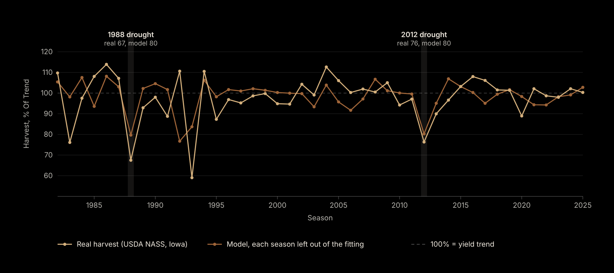<br><sub>Real Iowa corn harvests (USDA NASS) against the model, each season predicted with that season left out of the fitting.</sub></p>

- **It catches the big droughts**: 1988 and 2012 are two of its three worst seasons, scored without ever seeing those years.
- Its error over all 44 seasons (9.9 points) is lower than that of the long-term yield trend alone (11.3 points).

**Checked from space.** NASA Terra MODIS 16-day NDVI (via NASA GIBS, 250 m) over Story County cropland, 2000 to 2025, tracks the real Story County corn harvests (correlation **0.61**), so it is an independent check. The satellite and the model both show the 2012 drought: the satellite saw the crop peak early, on 11 July, and fade in August. Script: `simulator-source/tools/satellite_check.py`.

<p align="center">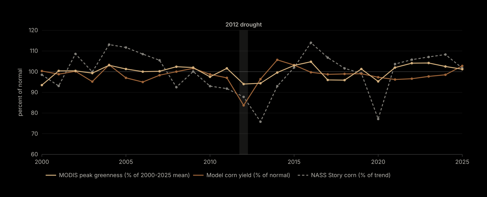<br><sub>NASA Terra MODIS peak greenness, the model and the real Story County corn harvest, 2000 to 2025.</sub></p>

**Checked in 14 counties.** The same model, with the settings fitted on Iowa and nothing refitted, was scored against each county's own USDA NASS yields (41 to 44 seasons each, the county's own NASA POWER weather and NRCS soil). Its error is smaller than the trend line's in 14 of 14 counties for corn and 13 of 14 for soybeans, by a small margin (median skill 0.14 and 0.11). It does best in Dane County, Wisconsin (corn skill 0.29) and Champaign County, Illinois (0.21). It is worse than the trend for O'Brien County, Iowa soybeans (-0.05), nearly flat in Christian County, Kentucky, and close to the trend line in ordinary seasons in about half the counties. Every county, good and bad, is in [`VALIDATION.md`](simulator-source/VALIDATION.md#multi-county-validation-14-counties). Script: `simulator-source/tools/validate_counties.py`.

<p align="center">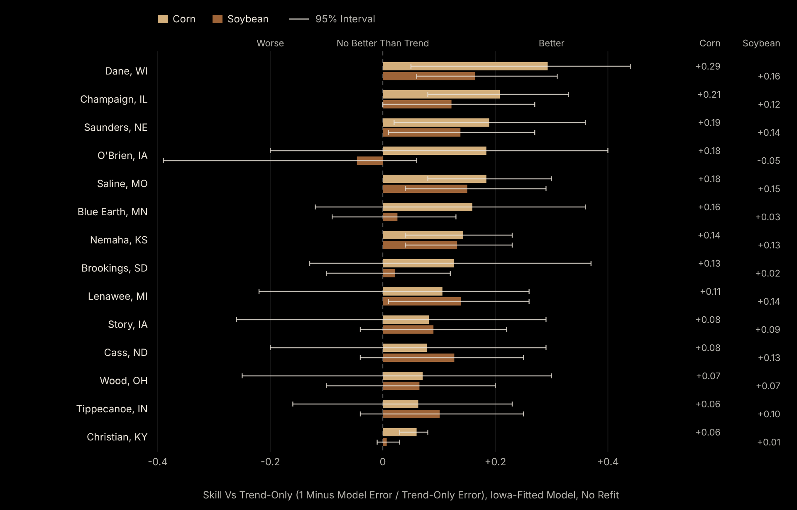<br><sub>Skill against the trend line in 14 counties (0 = no better than the trend), Iowa-fitted model, no refit.</sub></p>

The site's Project Details tab shows both charts (`public/images/validation-corn.svg`, `public/images/validation-counties.svg`).

---

## NASA Data

| Data set | Product and version | Parameters | Used for |
|---|---|---|---|
| **NASA POWER** daily point API | v2.10.3, AG community; built from NASA GMAO **MERRA-2** and NASA **CERES** SYN1deg | T2M_MAX, T2M_MIN, T2M, T2MDEW, RH2M, WS2M, ALLSKY_SFC_SW_DWN, PRECTOTCORR, PS | Every one of the 44 seasons, for the 14 built-in counties and for every imported field (its own ~0.5° grid cell) |
| NASA POWER climatology | monthly normals | as above | Shifting a county's daily weather to a farm's own spot |
| NASA POWER soil wetness | MERRA-2 GWETROOT, GWETTOP | 0 = dry, 1 = saturated | The model check (long record) and today's soil wetness against the 2001 to 2025 normal for the same two weeks (near-real-time) |
| **NASA GIBS**: MODIS Terra NDVI | `MODIS_Terra_L3_NDVI_16Day`, 250 m | NDVI | The independent check of the model (2000 to 2025) |
| **NASA GIBS**: VIIRS and MODIS thermal anomalies | `VIIRS_SNPP_Thermal_Anomalies_375m_All`, `VIIRS_NOAA20_Thermal_Anomalies_375m_All`, `MODIS_Combined_Thermal_Anomalies_All` | active fire, day and night | Confirming or softening each Sentinel-2 burned-ground warning; a 14-day fire line for the fields |

The fire layers are read as small PNG map images over each field (plus about 400 m) and decoded by our own PNG reader in `fieldfire.js` (zlib inflate, all five scanline filters, RGB/RGBA/grey/palette with transparency). They are map pixels, not FIRMS point records.

Without NASA POWER there is nothing to replay: it is the input to every simulation. If NASA POWER does not answer for an imported field, the server falls back to Copernicus ERA5 and says so on the page.

---

## Partner And Other Data

| Source | Used for |
|---|---|
| Copernicus **Sentinel-2 Level-2A** (ESA), via the Element 84 Earth Search STAC catalog and the public Cloud Optimized GeoTIFFs on AWS (us-west-2) | Field health, burned ground, bare soil, weak growth zones |
| **Copernicus DEM GLO-30** (30 m), public AWS bucket | Each field's slope, height and low spots |
| **ESA WorldCover 2021** (10 m, from Sentinel-1 and Sentinel-2) | Ponds, streams and wetlands in and around each field |
| **ECMWF IFS**, **Copernicus ERA5 / ERA5-Land**, **CAMS**, through Open-Meteo | Weather now, past 7 days and next 3; soil moisture; air quality; backup weather; the 30-day outlook |
| **USDA NRCS** Soil Data Access | Water each soil holds (aws0150wta), drainage class, slope; the soil water bucket |
| **USDA NASS** Quick Stats | County and state yields: the farm's normal harvest and the validation |
| **ISRIC SoilGrids** 250 m | Soils outside the US; organic carbon, nitrogen, pH and CEC for near-real-time conditions |
| **USDA NAIP** via USGS, **Sentinel-2 cloudless 2020** by EOX | The aerial picture the farm map is drawn from |
| Iowa State University crop budgets, USDA prices | Costs and prices |
| Photon (OpenStreetMap), US Census geocoder, FCC Area API | Finding the farm and its county |
| **Google Gemini** | The optional AI helpers (farm fit, chat, outlook note, translation) |

---

## Your Real Fields: The Import Pipeline

`fieldgeo.js`, `POST /api/fieldconditions`. A farmer drops a GeoJSON or KML file (from geojson.io, Google Earth, QGIS, John Deere Operations Center or Climate FieldView), or clicks **Iowa sample** / **California sample**. Up to four fields are used (the four largest); a `name` property names a field and a `crop` property (corn or soybean) sets its last crop.

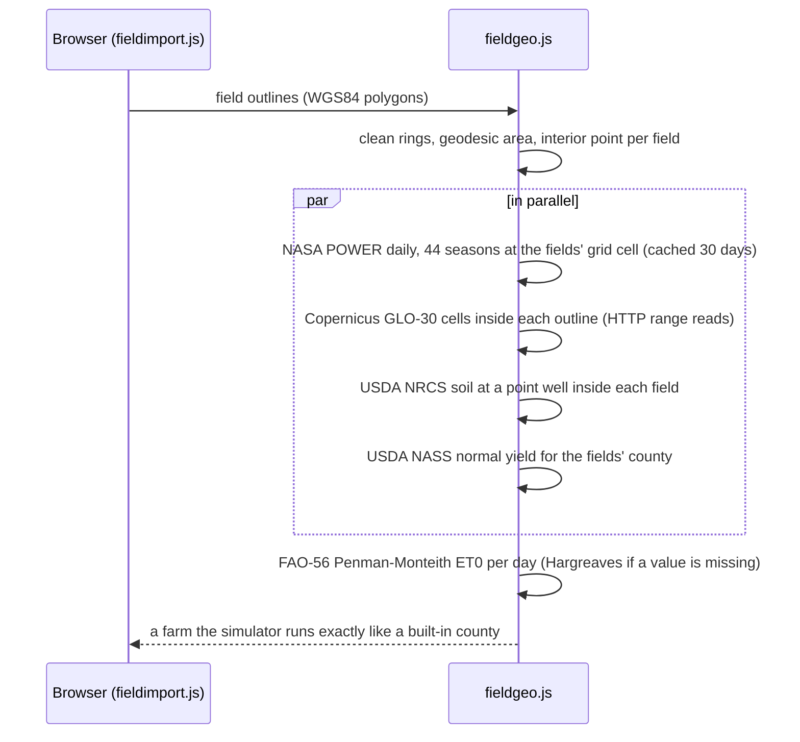

<p align="center"></p>

- **Weather:** NASA POWER first (`nasaPowerWeather`); only if it does not answer, Copernicus ERA5 / ERA5-Land from Open-Meteo's archive (`farmWeather`). Checked against the built-in Story County data: 869 mm against 867 mm of seasonal rain, and the same ET₀.
- **Terrain:** the GLO-30 Cloud Optimized GeoTIFF is read with HTTP range requests, only the tiles over the fields, and averaged over every 30 m cell inside each outline.
- About 30 seconds on a cold cache, a few seconds once cached.

---

## Advanced Near-Real-Time Conditions

`fieldlive.js`, `fieldsat.js`, `fieldfire.js`, `POST /api/liveconditions`. The third view of the Simulation panel. It shows how fresh each source is, checks again every 15 minutes while open, and pins each warning to a numbered spot on a small map of the fields.

| What it shows | Source | How fresh |
|---|---|---|
| Air temperature, humidity, wind, rain (past 7 days, next 3) | ECMWF IFS | Hourly |
| Air quality: PM2.5, desert dust, UV | Copernicus CAMS | Hourly |
| Topsoil and root-zone moisture | Copernicus ERA5-Land | About 5 days behind |
| Root-zone and topsoil wetness against normal | NASA POWER (MERRA-2) | About 3 days behind |
| Active fire over or near each field | NASA VIIRS and MODIS via NASA GIBS | Daily, last 14 days |
| Burned ground, bare soil, weak growth zones | Copernicus Sentinel-2 (10 to 20 m) | A new pass every 2 to 5 days |
| Ponds, streams and wetlands | ESA WorldCover 10 m | 2021 map |
| Low spots where water gathers | Copernicus GLO-30 | Fixed |
| Soil fertility: organic carbon, nitrogen, pH, CEC | ISRIC SoilGrids 250 m | Fixed |

<p align="center"></p>

**Burned ground.** Two Sentinel-2 images of the same tile are compared. A pixel counts when the Normalized Burn Ratio `NBR = (B8A − B12) / (B8A + B12)` was at least 0.15 before, is below −0.10 now, dropped by at least 0.27 (dNBR, a threshold from forest-fire work), and the near-infrared is dark like char (below 0.17). Only scene-classification classes 4, 5 and 6 (vegetation, bare soil, water) count as clear, and pixels within 40 m of cloud, shadow, snow or no-data in either image are left out. Because bare soil after harvest can pass this test, every warning is then checked against NASA's fire detections: "confirmed by fire" when NASA saw fire there in the burn window, otherwise "possible burned ground or bare soil after harvest, check on the ground". Tested near Patiala, Punjab, in the stubble-burning season: four patches of about 6 to 8 acres, with NASA MODIS fire on 3 and 5 November 2026 ([evidence](docs/evidence/burn-check-nasa-2026-11-16.json)).

**Time limits.** Every source has a 40-second deadline and the NASA fire and soil checks a 12-second budget (6 seconds more for the burn confirmation), so the answer always comes back inside a host's request limit; a late source is listed as "did not answer in time" and the rest still shows.

---

## Field Health From Sentinel-2

`fieldhealth.js`, `POST /api/fieldhealth`. The clearest Sentinel-2 image of each field in every 8 days of the season (about 20 to 25 images) becomes a time series, downloadable as CSV.

| Index | Formula (Sentinel-2 bands) | Read as |
|---|---|---|
| NDVI | (B8A − B4) / (B8A + B4) | Canopy greenness |
| NDRE | (B8A − B5) / (B8A + B5) | Chlorophyll / nitrogen, against the field's own best 10% |
| NDMI | (B8A − B11) / (B8A + B11) | Water in the leaves |
| Red-edge position (S2REP) | 705 + 35 × ((B4 + B7)/2 − B5) / (B6 − B5) nm (Frampton et al. 2013) | Leaf chlorophyll and structure |
| SAVI, LAI, cover | SAVI = 1.5 (B8A − B4) / (B8A + B4 + 0.5); LAI = −ln((0.69 − SAVI) / 0.59) / 0.91; cover = ((NDVI − 0.15) / 0.75)² | Leaf area (empirical, rough), ground cover |
| Uniformity | NDVI 10th and 90th percentiles and coefficient of variation | How even the field is |

<p align="center"></p>

Reflectance scale and offset follow the Sentinel-2 processing baseline 04.00 (the −1000 offset after January 2022, honouring `earthsearch:boa_offset_applied`).

From the series: growth stage (degree days since planting, checked against the greenness curve), growth momentum, scores for canopy, nitrogen, moisture, leaf structure and uniformity, a **health index** (0 to 100), a quality score, likely causes and advice ranked by priority for irrigation, nutrition, soil moisture and uniformity. Phosphorus cannot be read from orbit, so the page asks for a soil test instead of guessing. The red-edge nitrogen check cannot see a field that is short everywhere, so nitrogen advice says to confirm with a soil nitrate or tissue test first.

The bushel figure is labelled a **rough guide, not yet checked against real harvests**: county normal × (0.55 + 0.5 × health index / 100), with a design range of 0.85 to 1.15 times. These are rules on published indices, not a model trained on harvests. Evidence: [`docs/evidence/field-health-iowa-nasa-2026-11-16.json`](docs/evidence/field-health-iowa-nasa-2026-11-16.json).

---

## The Ten Helpers: A Multi-Agent Pipeline

EcoShift is built as ten helpers, each with one job, that pass their results along. Six are plain code; four use Google Gemini, and code checks and limits everything they return.

| # | Helper | Type | Job |
|---|---|---|---|
| 1 | Questionnaire | Plain code | Learns the farm: location, fields, last crops, water, land, limits, goals |
| 2 | Farm-Fit Helper | Gemini | Reads the answers about drainage, tiles and slope and proposes small changes: soil water-holding −15% to +10%, normal harvest ±10% (capped in code) |
| 3 | Crop Model | Plain code | Replays 44 NASA POWER seasons on each field |
| 4 | Adviser | Plain code | Ranks every option by average profit and worst-season results, with evidence, extra work and gaps |
| 5 | Chat Assistant | Plain code + Gemini | Rules turn known what-ifs into simulator actions; anything else goes to Gemini |
| 6 | Field Importer | Plain code | Reads field outlines and fetches their weather, terrain, soil and yields |
| 7 | Satellite Reader | Plain code | Reads only the Sentinel-2 pixels over the fields, plus NASA's fire check |
| 8 | Outlook Explainer | Gemini | Turns the 30-day forecast numbers into a short note |
| 9 | Translator | Gemini | Shows the simulator in the farmer's language |
| 10 | Map Maker | Image processing (Python, OpenCV) | Draws the farm map from aerial pictures and finds the fields |

**The chat path**, with the trace the farmer sees under every answer:

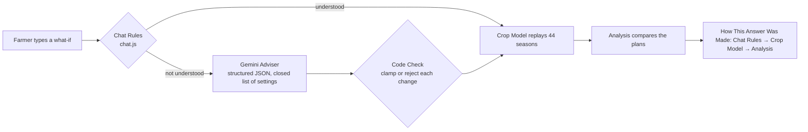

Guardrails:

- Gemini answers to a JSON schema and may only propose settings from a fixed list; the browser clamps out-of-range values and rejects anything else, and the crop model computes every number.
- The prompts carry the validation facts, so the chat states the model's real accuracy rather than overclaiming.
- Per-visitor rate limits on every AI route (see [API Reference](#api-reference)).
- Without a key, the rule chat, the model and every non-AI feature work the same; the farmer is told in plain words.
- A published check of the chat rules: `simulator-source/verify/chat_rules.json` (35 farmer questions with their expected actions), run with the 216 other chat cases in `verify/qa2/chat_test.js`.

---

## Languages

A language picker sits on the questionnaire's first screen and in the simulator's top bar: English, Spanish, Portuguese, French, Hindi, Chinese, Arabic, Swahili, Vietnamese, Ukrainian, or any other typed in. Every piece of screen text, chat answers and analysis included, is translated by Gemini through `POST /api/translate` in batches and kept in the farmer's browser, so each sentence is translated once (`simulator-source/src/i18n.js`). What the farmer types in the chat is put into English before the simulator reads it. Numbers, dates and the year strip are left as they are. Without a key the page stays in English and says so.

---

## The Farm Map

`farmmap/` (Python, OpenCV, scikit-image) and `farmmap.js`. EcoShift downloads the same 1.6 km square around the farm from two public sources, a USDA NAIP aerial photo (about 1 m, US only) and the Sentinel-2 cloudless 2020 map by EOX (10 m), keeps the sharper picture, and turns it into a flat illustrated map of fields, crop rows, trees, roads and water. Image processing finds the four fields with no hand drawing, and the weekly results colour them as the season plays. The 14 county maps are built in (`simulator-source/tools/build_farmmaps.py`). Drawing a new map needs Python on the server; a conversion peaks at about 415 MB of memory.

<p align="center">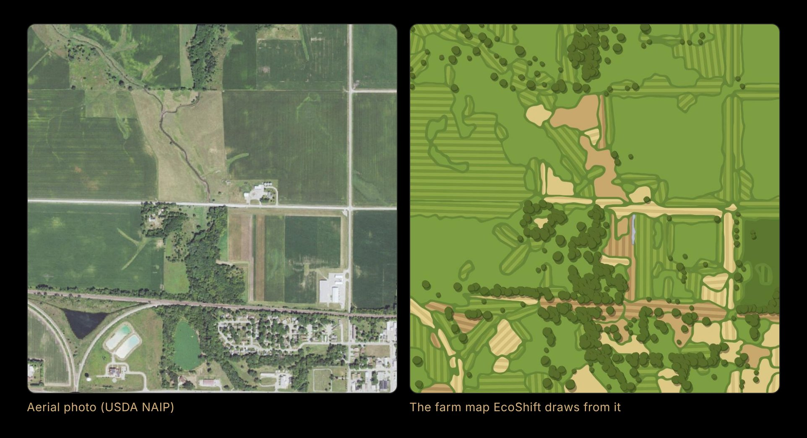</p>

---

## API Reference

All routes are handled by `server.js` (and on Vercel by `api/index.js`, which passes every `/api/...` request to the same handler). Limits are calls per visitor per 10 minutes; AI routes also share a total of 600 per 10 minutes.

| Method | Route | Purpose | Limit |
|---|---|---|---|
| GET | `/api/geocode?q=` | Address search and county lookup | 150 |
| POST | `/api/localfit` | Fit NASA POWER climate, NRCS soils and NASS yields to the farm's spot (+ Farm-Fit Helper) | 10 |
| GET | `/api/climate?lat=&lon=` | NASA POWER monthly record for a point, 1981 to now (temperature, rain, root-zone wetness) | 60 |
| GET | `/api/outlook?` | 30-day outlook (Open-Meteo) | 60 |
| POST | `/api/outlooknote` | Outlook Explainer note (Gemini) | 12 |
| POST | `/api/chat` | Chat Assistant's Gemini path | 40 |
| POST | `/api/simchat` | Simulation helper (Gemini) | 40 |
| POST | `/api/brief` | A plain-language rotation brief from the farmer's answers and NASA climate (Gemini) | 8 |
| POST | `/api/translate` | Translator (Gemini) | 120 |
| POST | `/api/fieldconditions` | Field import | 10 |
| POST | `/api/liveconditions` | Advanced Near-Real-Time Conditions | 30 |
| POST | `/api/fieldhealth` | Field Health | 10 |
| GET | `/api/farmmap?lat=&lon=` | Draw a farm map for a spot | 20 |
| POST | `/api/farmmap/upload` | Draw a farm map from an uploaded photo | 20 |
| GET | `/api/farmmap/img/:name` | A drawn map image | none |

Request bodies are size-capped, secrets and server files are never served, and the 30-day and 44-season downloads are cached on disk (`os.tmpdir()`).

---

## Run It Locally

1. Install **Node.js 18 or newer** (no `npm install` needed; there are no packages).
2. Optional, for the AI helpers: copy `.env.example` to `.env` and set `GEMINI_API_KEY=` (get one at https://aistudio.google.com/apikey). Without a key everything else works.
3. Optional, for drawing new farm maps: Python 3 and `pip install -r farmmap/requirements.txt`.
4. Start it:

   ```bash
   npm start
   ```

5. Open http://localhost:8787 (or the `PORT` you set). Stop with Ctrl+C.

The simulator also opens as a plain file (`public/deepdive/index.html`) and works offline on the built-in county data. **Never commit or upload `.env`.**

---

## Configuration

| Variable | Default | Meaning |
|---|---|---|
| `GEMINI_API_KEY` | none | Turns on the AI helpers. `GOOGLE_API_KEY`, `Gemini_Api` and `Gemini_key` are also accepted |
| `GEMINI_MODEL` | `gemini-3.5-flash-lite` | Model for the AI helpers |
| `GEMINI_CHAT_MODEL` | `GEMINI_MODEL` | Model for the chat |
| `PORT` | 8787 | Port for `node server.js` |
| `TRUST_PROXY` | unset | Number of proxies in front of the server, so per-visitor limits read `X-Forwarded-For` (1 for a single host proxy, 2 for Cloudflare in front of one). Leave unset when visitors connect directly. Not needed on Vercel, which provides `x-real-ip` |
| `FARMMAP_URL` | unset | On Vercel: the address of a full server that can draw farm maps; map requests are forwarded there |
| `FARMMAP_PYTHON` | `python3` | Python used for the farm map converter |

---

## Tests

| Command (in `simulator-source/`) | What it checks | Result |
|---|---|---|
| `node --test tests/engine.test.js` | The crop model: water balance, stages, planting, frost, rotation, money, insurance, climate scenarios | 38 of 38 pass |
| `node verify/qa2/chat_test.js dist/simulator.test.html out.md` | 264 chat cases, including the 35 published in `verify/chat_rules.json`, and the "How This Answer Was Made" trace | 264 of 264 (100%) |
| `node verify/qa2/setup_test.js dist/simulator.test.html` | Questionnaire, example farm, saved answers, phone layout | all pass |
| `node verify/qa2/realmap_test.js dist/simulator.test.html outdir` | The farm map view | all pass |
| `node verify/qa2/livemap_test.js dist/simulator.test.html outdir` | The near-real-time warnings map | all pass |
| `python3 tools/validate.py` | Re-runs the leave-one-year-out yield check (about 2 minutes) | writes `data/validation.json` and the tables in VALIDATION.md |
| `python3 tools/validate_counties.py` | The 14-county check, transfer and refit (2 to 5 minutes) | writes `data/validation_counties.json` and `public/images/validation-counties.svg` |
| `sha256sum -c raw/HASHES.txt` | Every raw NASA, USDA, NOAA and Open-Meteo download | matches |

The page tests use Playwright and run against `dist/simulator.test.html`. Build the simulator first:

```bash
cd simulator-source
python3 build.py   # writes dist/deep-dive.html; copy it to ../public/deepdive/index.html
```

---

## Deploying

**Vercel** (how the live site runs), set by `vercel.json`:

- `public/` is served as the website; the simulator, the 14 county farms and their maps run in the browser.
- `api/index.js` is the one Vercel function. A rewrite sends every `/api/...` request to it, and it passes the request to the same handler `node server.js` uses. One function keeps the site within the Hobby plan's limit of 12 functions per deployment; `maxDuration` is 60 seconds.
- `.vercelignore` leaves the Python tools, raw data and simulator sources out of the upload.
- Settings: Framework Preset "Other", Root Directory the repository root, environment variable `GEMINI_API_KEY`.
- Drawing a **new** farm map needs Python, which a Vercel function does not have. Set `FARMMAP_URL` to a full server to forward those requests; without it, a new address or photo shows the nearest example county's map.

**Any host with Node 18+**: `npm start`. Give it at least 1 GB of memory if the farm map converter is installed. Static pages are gzip-compressed and cached for 5 minutes. Health check: `GET /`.

**Docker**: `Dockerfile` (Node 20, Python 3 and the converter's packages) and `.dockerignore` (which leaves `.env` out). `deploy/huggingface/` holds a Dockerfile and Space README for a Hugging Face Docker Space (these need a Hugging Face PRO account as of November 2026). Neither has been built here; test before depending on them.

---

## Repository Layout

```
README.md, LICENSE, package.json      "npm start" runs server.js; no dependencies
server.js          the server: static files, every API route, Gemini helpers, rate limits
farmfit.js         farm fitting (NASA POWER, NRCS, NASS), 30-day outlook, address lookup
fieldgeo.js        field import: outlines, NASA POWER 44 seasons, GLO-30 terrain, soils, yields; COG reader
fieldlive.js       Advanced Near-Real-Time Conditions: all sources, deadlines, warnings
fieldsat.js        Sentinel-2 search (Earth Search STAC) and pixel reading, burn test, weak zones
fieldfire.js       NASA GIBS fire detections with a built-in PNG decoder
fieldhealth.js     Field Health: the season series, indices, scores, causes and advice
chatai.js          the Chat Assistant's Gemini path
farmmap.js         farm map service (runs farmmap/ or forwards to FARMMAP_URL)
farmmap/           the farm map converter (Python, OpenCV) with examples
api/index.js       the single Vercel function
vercel.json, .vercelignore, Dockerfile, .dockerignore, deploy/huggingface/
docs/evidence/     saved responses from the live checks (Iowa fields, Patiala burn check)
public/            the website
  index.html, styles.css, app.js     the four tabs
  sim-guide.js / .css                the guided tutorial
  images/                            screenshots, charts (validation-corn.svg, satellite-check.svg), logo
  deepdive/index.html                the simulator (one self-contained page, built from simulator-source/)
  deepdive/sample-fields.geojson, california-fields.geojson   sample field outlines
simulator-source/
  src/             engine.js (crop model), chat.js, analysis.js, questionnaire.js, controls.js, fieldview.js,
                   fieldimport.js, conditions.js, outlook.js, farmmap.js, i18n.js, sites.js (14 counties), app.js, CSS
  raw/             the raw NASA POWER, Open-Meteo, NRCS, NOAA and USDA downloads, SHA-256 in raw/HASHES.txt
  data/            NASS yields, validation results, the satellite check
  tools/           scripts that rebuild the data, the farm maps, the validation and the satellite check
  tests/, verify/  model tests, page tests and the published chat checks
  VALIDATION.md, DATA_NOTES.md, CONTRACT.md, QUESTIONNAIRE.md, REALMAP.md   how it was checked and where every number comes from
```

---

## Research And Testing

- [`docs/technical-report.md`](docs/technical-report.md): the model, data sources, assumptions, validation method, results and limitations in one report.
- [`docs/portfolio.md`](docs/portfolio.md): the architecture, the hardest engineering problems, what did not work, what we learned and the team's contributions.
- [`docs/farmer-testing/`](docs/farmer-testing/): our plan for testing EcoShift with farmers and extension specialists (no sessions have been run yet).

---

## Credits And Licenses

- **NASA POWER**, NASA Langley Research Center (MERRA-2 from NASA GMAO, CERES SYN1deg): daily weather and soil wetness. https://power.larc.nasa.gov/
- **NASA GIBS**, NASA EOSDIS: MODIS Terra NDVI and VIIRS / MODIS thermal anomalies.
- **Copernicus Sentinel-2** (contains modified Copernicus Sentinel data 2025-2026), read through Element 84 Earth Search on AWS; **Copernicus DEM GLO-30**; **ESA WorldCover 2021** (CC BY 4.0).
- **ECMWF**, **Copernicus ERA5 / ERA5-Land** and **CAMS** through **Open-Meteo** (CC BY 4.0).
- **USDA NRCS** Soil Data Access; **USDA NASS** Quick Stats; **USDA NAIP** via the USGS National Map (public domain).
- **Sentinel-2 cloudless 2020** by EOX IT Services (https://s2maps.eu, CC BY-NC-SA 4.0).
- **ISRIC SoilGrids** (CC BY 4.0); **Photon** and **OpenStreetMap** contributors (ODbL); **US Census** geocoder; **FCC** Area API.
- Iowa State University Extension crop budgets; FAO-56 and FAO-33 methods.
- **Google Gemini** for the optional AI helpers.

Code: MIT License, see [`LICENSE`](LICENSE).

Built by **Shaurya** and **Arnav** (Emerald High School) and **Ghrini** (Dougherty Valley High School) for the 2026 NASA Space Apps Challenge.
