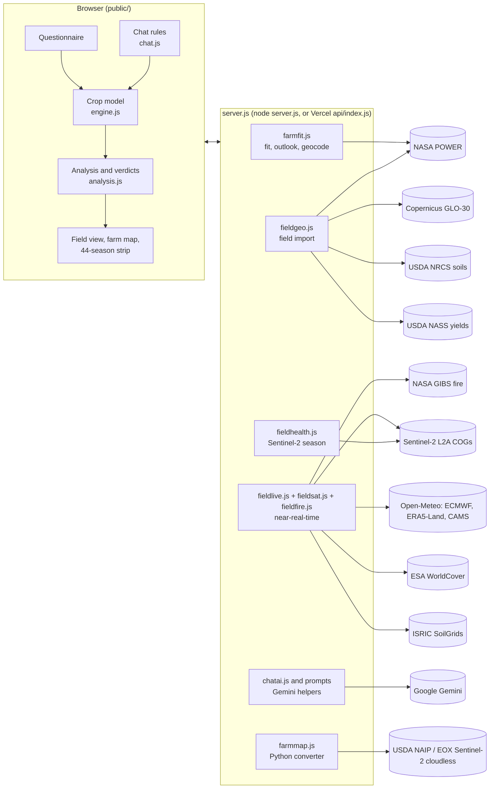
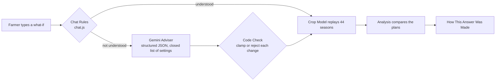

# EcoShift Engineering Portfolio

How EcoShift is built, the hardest problems we solved, what did not work, what we learned and what we would research next. This is the project's story for reviewers. For the science, read [`technical-report.md`](technical-report.md). For the numbers, read [`simulator-source/VALIDATION.md`](../simulator-source/VALIDATION.md).

Live site: https://ecoshift-final-8dsi.vercel.app/
Challenge: 2026 NASA Space Apps, "Field Shift: Adapting Farms with NASA Data"
Team: Shaurya and Arnav (Emerald High School), Ghrini (Dougherty Valley High School)

## Contents

1. Architecture Overview
2. Data Ingestion
3. Geospatial Analysis And Satellite Integration
4. Crop Simulation
5. Multi-Agent Architecture
6. AI Integration And Safeguards
7. Frontend And Backend
8. Automated Testing
9. Deployment And Reliability
10. The Hardest Engineering Problems We Solved
11. What Did Not Work
12. What We Learned
13. Next Research Questions
14. Team Contributions

---

## 1. Architecture Overview

One Node.js handler (`server.js`, no npm dependencies) serves the website and every API route. The same handler runs as `node server.js` on any host and as the single Vercel function `api/index.js`. The simulator and its crop model run entirely in the browser. The server fetches and caches public data, runs the field checks and talks to Google Gemini.

Rules that run through the whole design:

- **Deterministic numbers.** Every harvest and dollar figure comes from the crop model, never from the AI.
- **Degrade, do not fail.** With no AI key, no Python, or a slow outside service, the rest keeps working and the page says what is missing.
- **Tag every constant** as SOURCED, FITTED or DESIGN.
- **Pin raw data** with SHA-256 hashes in `simulator-source/raw/HASHES.txt`.

## 2. Data Ingestion

- **Built-in counties.** `simulator-source/tools/build_data.py` and `build_sites.py` (Python standard library only) turn raw downloads into the generated `climate.js` and `sites.js` for 14 counties. Rebuilding from the saved raw files reproduces `sites.js` exactly (checked 15 November 2026, `DATA_NOTES.md`). Every download has a URL and hash.
- **Imported fields.** `fieldgeo.js` takes GeoJSON or KML outlines, cleans the rings, finds the geodesic area and an interior point, then in parallel fetches 44 seasons of NASA POWER weather (cached 30 days), Copernicus GLO-30 terrain, USDA NRCS soil and USDA NASS county yields. It builds a farm that the simulator runs exactly like a built-in county.
- **Fallbacks.** If NASA POWER does not answer, the server uses Copernicus ERA5 through Open-Meteo and says so on the page.
- **Validation data.** `tools/validate_fetch_nass.py` pulls NASS yields and stores the query URL and a hash for each raw CSV. We checked values by hand against published figures (for example 2012 = 137 and 2011 = 172 bu/acre).
- **Caching.** The 30-day outlook and 44-season downloads are cached on disk (`os.tmpdir()`), so a cold import takes about 30 seconds and a warm one a few seconds.

## 3. Geospatial Analysis And Satellite Integration

- **Terrain from Copernicus DEM.** Slope, height and low spots are averaged over every 30 m cell inside each field outline, using Horn's 3 x 3 method (`fieldgeo.js`).
- **Sentinel-2 field health** (`fieldhealth.js`): the clearest image of each field in every 8-day window of the season (about 20 to 25 images), turned into NDVI, NDRE, NDMI, red-edge position, SAVI, LAI, cover and uniformity, then scores and advice. Reflectance follows processing baseline 04.00.
- **Burned ground** (`fieldsat.js`, `fieldfire.js`): the Normalized Burn Ratio compared between two images, with thresholds and a cloud and shadow mask, then checked against NASA fire detections.
- **Near-real-time conditions** (`fieldlive.js`): weather, air quality, soil moisture, NASA soil wetness, fire, burned ground, ponds, low spots and soil fertility on one screen, each with its freshness.
- **Farm map** (`farmmap/`, Python with OpenCV and scikit-image): finds the four fields from a USDA NAIP photo or Sentinel-2 cloudless image and draws an illustrated map.

## 4. Crop Simulation

`simulator-source/src/engine.js` replays one season through each field day by day: a FAO-56 two-layer soil-water balance, FAO-56 Penman-Monteith ET0, growing-degree-day stages, a planting rule, frost, rotation and cover-crop effects, and a yield formula where only the weather-stress part is compressed by a fitted exponent. Three weather exponents are fitted per crop by leave-one-year-out against USDA NASS Iowa yields. Full detail in [`technical-report.md`](technical-report.md), sections 5 to 7.

## 5. Multi-Agent Architecture

EcoShift is ten helpers, each with one job, that pass results along. Six are plain code and four use Gemini. Code checks and limits everything the AI returns.

| # | Helper | Type |
|---|---|---|
| 1 | Questionnaire | Plain code |
| 2 | Farm-Fit Helper | Gemini |
| 3 | Crop Model | Plain code |
| 4 | Adviser | Plain code |
| 5 | Chat Assistant | Plain code, then Gemini |
| 6 | Field Importer | Plain code |
| 7 | Satellite Reader | Plain code |
| 8 | Outlook Explainer | Gemini |
| 9 | Translator | Gemini |
| 10 | Map Maker | Image processing (Python, OpenCV) |

The chat path shows the pattern. Plain rules first, Gemini only when the rules do not understand, then a code check, then the crop model, and finally a visible trace.

## 6. AI Integration And Safeguards

- Gemini answers to a JSON schema and may only propose settings from a fixed list. The browser clamps out-of-range values and rejects anything else. The crop model computes every number.
- The Farm-Fit Helper can only make small, capped changes (soil water-holding -15% to +10%, normal harvest +/-10%).
- The prompts carry the validation facts, so the chat states the model's real accuracy.
- Under every answer, "How This Answer Was Made" lists which helpers ran, so the farmer can see what was code and what was AI.
- Per-visitor rate limits on every AI route and a shared total of 600 calls per 10 minutes.
- With no key, the rule chat, the model and all non-AI features work the same.
- 251 chat cases pass, including the 35 published in `verify/chat_rules.json`.

## 7. Frontend And Backend

- **Frontend.** `public/` holds the four-tab site (Home, Project Details, Simulation, About Us). The simulator is one self-contained HTML file built from `simulator-source/src/` by `build.py`, so it can also open from a file and works offline on the built-in counties. It has a guided 16-step tutorial with large text, keyboard controls, screen-reader support and an optional voice, a questionnaire, a phone layout and translation into the farmer's language.
- **Backend.** `server.js` (about 720 lines) handles static files, every API route, rate limits, body-size caps and Gemini calls. `farmfit.js`, `fieldgeo.js`, `fieldlive.js`, `fieldsat.js`, `fieldfire.js`, `fieldhealth.js`, `chatai.js` and `farmmap.js` hold the data work. No npm dependencies: only Node 18 or newer.
- **Routes.** 15 API routes listed in the README's API Reference.

## 8. Automated Testing

| Command (in `simulator-source/`) | What it checks | Result in README |
|---|---|---|
| `node --test tests/engine.test.js` | The crop model: water balance, stages, planting, frost, rotation, money | 30 of 30 pass |
| `node verify/qa2/chat_test.js dist/simulator.test.html out.md` | 251 chat cases and the "How This Answer Was Made" trace | 251 of 251 |
| `node verify/qa2/setup_test.js dist/simulator.test.html` | Questionnaire, example farm, saved answers, phone layout | all pass |
| `node verify/qa2/realmap_test.js` and `livemap_test.js` | The farm map view and the near-real-time warnings map | all pass |
| `python3 tools/validate.py` | Re-runs the leave-one-year-out yield check (about 2 minutes) | writes `data/validation.json` |
| `sha256sum -c raw/HASHES.txt` | Every raw download | matches |

Beyond tests, the live checks are saved as evidence (`docs/evidence/`): the Iowa field health response and the Patiala burn check, each from 16 November 2026.

## 9. Deployment And Reliability

- **Vercel** serves `public/` as the site and one function, `api/index.js`, for every API route, with `maxDuration` 60 seconds.
- **Any Node 18+ host** runs `npm start`. A Dockerfile and a Hugging Face Space folder are included but have not been built here, so we say that in the README.
- **Time limits.** Every outside data source has a 40-second deadline, and the NASA fire and soil checks a 12-second budget (6 seconds more for burn confirmation). A late source is shown as "did not answer in time" and the rest still shows.
- **Graceful fallbacks** for NASA POWER (to ERA5), Gemini (rule chat), Python (nearest example county map).
- **Security basics.** Request bodies are size-capped, secrets and server files are never served, per-visitor rate limits, `.env` is never committed.

---

## 10. The Hardest Engineering Problems We Solved

### 10.1 One Vercel function for every API path

The Hobby plan allows 12 functions per deployment, and EcoShift has 15 routes. We could not use one file per route. We moved to a single function, `api/index.js` (commit `e155ed8`), and a rewrite in `vercel.json` that sends every `/api/...` request to it, where it calls the same `handle` function that `node server.js` uses.
It then took two more fixes. Vercel adds its own query (`?__p=<path>&path=<path>`) to a rewritten request, which made some routes not match. We first added a temporary request echo to see exactly what arrived (`3ac7a22`), then cleaned the query so the handler sees the exact address the browser asked for (`25f0561`). The outcome is one function, the same code locally and on Vercel, and no route-specific logic in the deployment config.

### 10.2 Reading only the needed bytes of Sentinel-2 and Copernicus DEM

Sentinel-2 scenes and DEM tiles are big files. A field covers a few pixels. Both are Cloud Optimized GeoTIFFs on public AWS buckets, so `fieldgeo.js` and `fieldsat.js` read the header, work out which internal tiles overlap the field, and fetch only those byte ranges with HTTP `Range` requests (`fieldgeo.js` reads the first 64 KB, then each needed tile by offset and length). This keeps a field check to a few seconds of download instead of whole scenes, and it needs no GDAL or other library. We average terrain over every 30 m cell inside each outline rather than sampling one point.

### 10.3 Decoding NASA GIBS fire PNGs without libraries

NASA GIBS serves fire detections as map images, not point records. `fieldfire.js` fetches a small PNG over each field (plus about 400 m) and decodes it itself using Node's built-in `zlib`: it concatenates the IDAT chunks, inflates them, undoes all five scanline filters, and handles RGB, RGBA, grey and palette images with transparency. A pixel that is not transparent is a detection. A library would have broken our no-dependencies rule, and the whole file, decoder included, is about 117 lines. The README says plainly that these are map pixels, not FIRMS point records.

### 10.4 A 40-second deadline per data source

A live conditions request touches about ten outside services, and any one can hang. Vercel stops a function after its limit, and a half-finished answer is worse than none. Every source in `fieldlive.js` has a 40-second deadline, the NASA fire and soil checks share a 12-second budget (plus 6 seconds for burn confirmation), and each fetch is cancelled with `AbortSignal.timeout`. A source that is late is listed as "did not answer in time" and the rest of the screen still shows. The commit that added the deadline is `bc5ac07` ("live conditions answer within 40 s so Vercel never times out").

### 10.5 Keeping AI out of the numbers

A chat that can say anything can also say wrong numbers. We split the system so the AI cannot calculate. Gemini returns JSON that must fit a schema, chooses only from a fixed list of settings, and the browser clamps or rejects what it returns. The crop model then computes the result. The prompts also carry the real validation numbers, so the AI states the honest accuracy. Under each answer, a trace shows which helpers ran. Checked by 251 chat cases.

### 10.6 Leave-one-year-out validation

With 44 seasons, fitting and testing on the same years gives flattering numbers. We built `tools/validate.py` to refit the three weather exponents and choose the structural settings inside each of 44 folds, predict the held-out season, and compare against a trend-only guess, ridge regression and gradient boosting. The result was uncomfortable (see 11.1), but the method made the audit possible, and the whole check re-runs in about 2 minutes.

### 10.7 Checking our weather data against stations

An audit suspected NASA POWER's cold fall nights, and a first fix that matched POWER to ERA5 cut corn r from 0.48 to 0.19. We went to three NOAA GHCN-Daily stations near Ames (through a public AWS copy, since two NOAA web services were blocked in our build environment). They showed POWER within -0.1 to +1.2 C of the stations and ERA5 running 1.4 to 2.6 C warm. We reverted the change because the station data said so, not because of the score.

---

## 11. What Did Not Work

These come from `VALIDATION.md` (audit rounds) and the git history.

### 11.1 The original headline was too strong

At first the model was calibrated on one year (gamma set so 2012 corn gave 77%). Scored against NASS it reached corn r 0.36 and no real skill over trend. After we moved to leave-one-year-out, the round 3 audit reproduced our numbers and found the headline stronger than the evidence. The final result: corn r 0.48 and RMSE 9.9 against 11.3 for trend-only over 44 seasons, but no skill outside 1988 and 2012 (RMSE 9.9 against 9.7, r 0.27). We rewrote the headline, the README and the site wording to say this. Later, the site and README wording was made positive again and kept in step with the evidence (commits `f420a66`, `2ba90bd`).

### 11.2 One fitted exponent shrank the real management effects

Applying gamma to every multiplier made corn after corn cost 0.5 points instead of about 8.5%. Gamma now applies only to the weather-stress part, and planting date, frost, rotation and cover-crop effects are applied afterwards.

### 11.3 Record-yield years ranked as disasters

2017 and 2021 ranked 4th and 3rd worst. The model's roots found subsoil as dry as the root zone above, and it had no water-table supply. We added a two-layer 1.5 m profile and an FAO-56 capillary rise term. They now rank 10th and 9th lowest, though the likely rest of the miss is the difference in rain between POWER and ERA5, which we cannot fix here.

### 11.4 Heat damage could not be fitted

The fitted corn heat slope is 0. Heat is not identifiable from this yield record, so the temperature slider uses a published-average floor, and we say it is an assumption.

### 11.5 Gradient boosting and "more AI" did worse

Gradient boosting scored r 0.20 and RMSE 11.9 for corn, worse than trend-only. With 43 training seasons the trees overfit. Ridge regression did beat our process model, but cannot compare rotations, so we kept the process model and recorded the deviation from our own pre-registered rule.

### 11.6 Matching POWER to ERA5 on frost

This reduced corn r to 0.19 and was reverted after station data contradicted it (see 10.7).

### 11.7 "Typical year" was a cool year

The old typical year (1984) was the fourth coolest of 44 seasons, so a 1 C cooler season meant a hard frost at the dough stage. Typical year is now the season closest to the median in both June to August rain and May to September warmth: 2011.

### 11.8 The Vercel routing

Two false starts before the single-function rewrite worked (see 10.1).

### 11.9 Things we could not do

- NOAA and Iowa Environmental Mesonet web services were blocked in our build environment.
- The Open-Meteo free tier returned HTTP 429 for six counties in the first build, so they borrowed Story County's heat thresholds. A later run filled in five of them. Christian County, Kentucky still reuses Story County's.
- CropScape failed TLS in our environment, so the MODIS check uses a hand-built cropland mask, and we did not disable TLS.
- Drawing a new farm map needs Python, which Vercel does not provide.
- We have not yet tested the tool with farmers.

## 12. What We Learned

- A validation that disappoints is more useful than a number we like. Reporting "no skill outside the two droughts" made the tool's claims smaller and more honest, and made every later claim believable.
- Check data against independent measurements. The station comparison changed a decision that the model score alone would have pushed the other way.
- A simple statistical model can beat a careful process model on a prediction test and still be the wrong tool, because it cannot answer the question the user asks.
- Tag every constant by where it came from. When a reviewer asks "where does this number come from?", the answer is in the code.
- Limits of the host shape the design: the 12-function limit, request timeouts and memory all decided what we built.
- Fewer dependencies means more work (a PNG decoder, a COG reader) but also fewer ways to break, and everything runs anywhere with Node.
- Honest wording is a feature. We changed wording on the site many times to match what the evidence supports.
- Real users are still missing. We built a testing plan (`docs/farmer-testing/`) because we do not know yet whether it helps decisions.

## 13. Next Research Questions

1. Does the model show skill in counties other than Story County, and does skill outside drought years improve with a county-specific fit? (See the Multi-County Results section of the technical report.)
2. If we replace the model's weather response with a regression and keep the process model for management effects, does the combined tool beat both?
3. How does the ranking of rotations change under projected, downscaled future weather, compared with replaying 1982 to 2025?
4. Can field trial or long-term experiment data validate the cover-crop and rotation effects that now come from budgets and trials?
5. Can Sentinel-2 field health predict measured yield on real fields, and how large is the error?
6. How often does the burned-ground check give false positives across regions and seasons?
7. How should drought-year price changes and crop insurance enter the money results?
8. Does seeing the 44-season spread change what farmers decide, and what do they need to see before they act? (Answered only by the farmer tests.)
9. Can tile drainage be added, and does it change the ranking on poorly drained soils?

---

## 14. Team Contributions

This section is a template. Each member fills in their own part. We have not guessed who did what.

### Shaurya

[describe what you built]

### Arnav

[describe what you built]

### Ghrini

[describe what you built]
