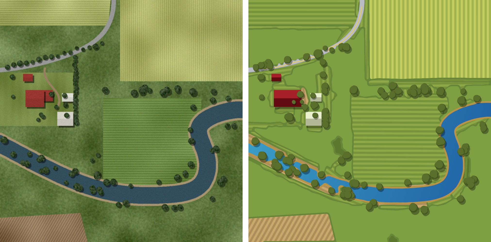

# Farm map converter

Turns a top-down aerial / satellite photo of farmland into a flat, illustrated
map: striped crop fields, round cartoon trees with shadows, a blue river with a
tan bank, grey roads with a yellow centre line, and two-tone roofs.

It is plain image processing: free, offline, no AI and no API key.

## Install

Needs Python 3.9 or newer.

    pip install -r requirements.txt

## Use

    python stylize_farm.py my_photo.png

This writes `my_photo_illustrated.png` next to the photo. Other options:

    python stylize_farm.py my_photo.png -o result.png      # choose the output name
    python stylize_farm.py my_photo.png --debug -v         # also save what was detected
    python stylize_farm.py --help                          # every setting

No photo to hand? `python make_test_aerial.py` makes a fake one
(`test_aerial.png`) to try it on.

## Tips

- Use a straight-down view. On Google Maps, turn labels off before taking the
  screenshot; on Google Earth, press U (look down) and N (north up).
- Trees too big or too small: `--tree-size 24` (default 15).
- Fields chopped into too many pieces: raise `--wall-strength` (e.g. 0.7) or
  `--merge`; fields joined that should be separate: lower them.
- Golf courses / open parkland sometimes look tidier with the older field
  method: `--fields felz`.
- `--debug` writes `*_masks.png` showing water (blue), trees (green), shadows
  (purple), roads (pink), buildings (red boxes) and field outlines.

## What works and what doesn't

Good: farms, parks, golf courses, rice paddies with visible field edges.
Rough: dense patchworks of tiny fields at low resolution, towns and suburbs,
murky green or brown water, snow, and anything that isn't a top-down photo.
Expect to adjust a setting or two per photo.

## Where to get photos

Google Maps / Google Earth imagery is copyrighted, and Google's terms don't
allow tracing it or making derivative works from it. A private picture of
your own land is low-risk, but for anything you publish or sell, use your own
drone photo or public-domain imagery (for example USDA NAIP in the US).

## Optional: Gemini scripts (`optional_gemini/`)

`gemini_stylize.py` redraws a photo with a Google Gemini image model, using
`style_example.png` as the style reference. It needs a Google AI Studio key in
the `GEMINI_API_KEY` environment variable, and image models need billing
enabled on that key (the free tier allows 0 images). `gemini_segment.py` asks a
free Gemini vision model to outline fields; its outlines were too rough to be
useful in testing.
