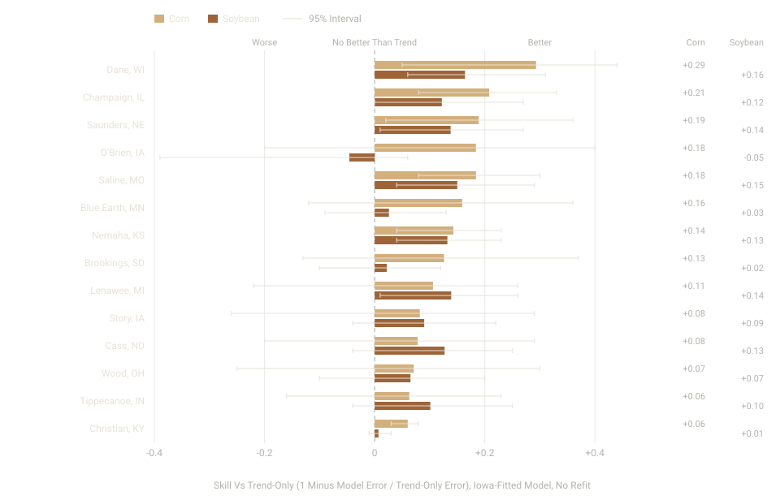

# Validation: how well does the simulator's weather response match real Iowa yields?

**Headline (revised after the round 3 audit).** The simulator's weather response catches the two big Iowa droughts (1988, 2012) but, tested one season at a time against NASS Iowa yields 1982-2025, it does **no better than the long-term yield trend in ordinary years** (corn: r 0.48 over all 44 seasons, RMSE 9.9 points of a normal crop against 11.3 for a trend-only guess, but without 1988 and 2012, r 0.27 and RMSE 9.9 against 9.7). Soybean: r 0.27, RMSE 9.5 against 9.8 over all seasons, r -0.06 without the two droughts. A small ridge regression on six weather numbers does better on the same test (corn r 0.58, 9.1 points; soybean r 0.55, 8.2 points); see section 8 for why it is not the yield engine. One season can be off by about 10 points of a normal crop, so small differences between plans are not reliable. Section 8 lists exactly what the numbers do and do not show.

Everything below is reproducible:

```
python3 tools/validate_fetch_nass.py   # NASS yields -> data/iowa_yields.json (raw CSVs in data/nass/)
python3 tools/validate.py --write      # fit + leave-one-year-out test -> data/validation.json, tables below, FIT/VALIDATION in src/engine.js
node --test tests/engine.test.js
```

## 1. Data

| What | Source | Where |
|---|---|---|
| Iowa state corn and soybean yields 1975-2025 (bu/acre, survey, annual) | USDA NASS Quick Stats, pulled 2026-11-15 through the public web tool (the API needs a key; the script uses the same three calls the web tool makes) | `data/iowa_yields.json` (every value, query, sha256 of each raw CSV, and a `results_url` that reopens the exact query in the NASS tool), `data/nass/*.csv` |
| Story County corn and soybean yields (secondary check: the county the POWER grid cell sits in) | same | same |
| Daily weather 1981-2025 for one grid cell (42.03 N, 93.47 W) | NASA POWER (MERRA-2 based), `src/climate.js` | see DATA_NOTES.md |
| Cross-check weather | Open-Meteo ERA5 archive, `raw/openmeteo.json` | used only to explain misses |

Every yield value comes from NASS; nothing was typed in by hand. Spot checks against published figures: 2012 = 137 and 2011 = 172 (Gazette), 2023 = 201, 2024 = 211, 2025 = 210 bu/acre (NASS Iowa annual summaries). The 2026 value in the download (219) is the in-season forecast and is excluded.

## 2. Method

- **Target.** Yield ratio = NASS yield / technology trend. The trend is a robust straight line (Tukey bisquare) through 1982-2025. Inside each fold the trend is refitted without the held-out season, and the held-out season's ratio is taken against that trend, so no season ever sees its own yield.
- **Folds.** Leave one year out: 44 folds, one per season 1982-2025. Every model below uses the same folds and the same ratios.
- **Process model (this simulator).** The engine itself (`tools/validate_model.js` loads `src/engine.js` in Node) produces, for the baseline rotation on the county reference soil, the per-season water stress Yw, waterlogging Yww, hot degree-days, grain-fill length, planting-date factor PD and frost factor Yf. In each fold, on the 43 training seasons, `tools/validate.py` chooses the structural setting (rooting depth 1.2 or 1.5 m; season start fixed or carried over from the season before; water-table ceiling 0, 2, 4 or 6 mm/day: 16 combinations) and fits three numbers by least squares: the compression exponent **gamma**, the heat slope **b** and the grain-fill exponent **eDur**. It then predicts the held-out season. Soybean uses its own gamma, b and eDur and the structural setting corn chose (the engine has one).
- **Statistical models.** Ridge regression (penalty chosen by leave-one-out inside the 43 training seasons) and gradient boosting (depth-2 trees, 200 trees, learning rate 0.05) on six season features from the same POWER cell: June-August rain and its square, July-August hot degree-days above the matched 30 C threshold, May-September growing degree-days, April-June rain, and July-August MERRA-2 root-zone wetness (GWETROOT). A "hybrid" ridge on the process model's own stress indices is reported too.
- **Trend-only.** Predicts ratio 1 (the trend itself).
- **Metrics** on the 44 out-of-sample predictions: Pearson r, Spearman r, RMSE in points of the trend, skill = 1 - RMSE / RMSE(trend-only). Also without 1993 (Midwest flood) and 2020 (derecho, wind not in weather data), and without 2012.

## 3. Results

<!-- auto:start -->
### Corn: Iowa state yields (NASS), leave-one-year-out, 44 seasons 1982-2025

| Model | Pearson r | Spearman r | RMSE (points of trend) | Skill vs trend-only | RMSE excl. 1993, 2020 | RMSE excl. 2012 |
|---|---|---|---|---|---|---|
| Process model (this simulator; 3 fitted numbers + rooting depth/start chosen in each fold) | 0.48 | 0.24 | 9.9 | 0.12 | 9.2 (skill 0.03) | 9.9 (skill 0.08) |
| Ridge regression on 6 POWER season features | 0.58 | 0.56 | 9.1 | 0.20 | 7.8 (skill 0.18) | 9.1 (skill 0.15) |
| Gradient boosting (depth-2 trees) on the same features | 0.20 | 0.23 | 11.9 | -0.06 | 10.4 (skill -0.10) | 12.0 (skill -0.11) |
| Ridge on the process model's stress indices | -0.20 | -0.09 | 13.3 | -0.18 | 11.8 (skill -0.25) | 13.1 (skill -0.21) |
| Trend only (predicts the trend) | - | - | 11.3 | 0 | 9.5 | 10.8 |

Ordinary years (1988 and 2012 left out): process r 0.27, RMSE 9.9 vs 9.7 for trend-only (skill -0.02); also without 1993 and 2020: r -0.01, RMSE 9.2 vs 7.4 (skill -0.26). Bootstrap 95% interval for the all-years r: [-0.02, 0.78]. Spread: observed sd 11.2 points, predicted 7.1 (ratio k = 1.56); mean of the 5 worst seasons observed 0.73, predicted 0.82.

Secondary check, Story County NASS yields (the county the POWER grid cell sits in), process model refitted the same way: Pearson r 0.28, Spearman r 0.06, RMSE 12.6 points vs 12.8 for trend-only (skill 0.02); excluding 1993 and 2020: r 0.10, skill -0.13.

Shipped parameters (fitted on all 44 seasons): rooting depth 1.5 m, season start 'fixed', water-table ceiling crMax 6 mm/day, gamma 0.315, heat slope b 0.00000 per degree-day, grain-fill exponent eDur 0.238. Settings chosen inside the folds: 1.5 m/fixed/cr 6 x44.

| Season | NASS yield (bu/acre) | Observed ratio | Process (LOYO) | Ridge (LOYO) | Note |
|---|---|---|---|---|---|
| 1982 | 120 | 1.10 | 1.05 | 1.03 |  |
| 1983 | 87 | 0.76 | 0.98 | 0.92 |  |
| 1984 | 112 | 0.98 | 1.08 | 0.92 |  |
| 1985 | 126 | 1.08 | 0.94 | 0.99 |  |
| 1986 | 135 | 1.14 | 1.08 | 1.00 |  |
| 1987 | 130 | 1.07 | 1.03 | 1.04 |  |
| 1988 | 84 | 0.67 | 0.80 | 0.87 | drought |
| 1989 | 118 | 0.93 | 1.02 | 1.01 |  |
| 1990 | 126 | 0.98 | 1.05 | 0.93 |  |
| 1991 | 117 | 0.89 | 1.02 | 1.00 |  |
| 1992 | 147 | 1.11 | 0.77 | 1.10 |  |
| 1993 | 80 | 0.59 | 0.84 | 0.91 | flood (not a weather-model year) |
| 1994 | 152 | 1.11 | 1.06 | 1.05 |  |
| 1995 | 123 | 0.87 | 0.98 | 0.98 |  |
| 1996 | 138 | 0.97 | 1.02 | 1.10 |  |
| 1997 | 138 | 0.95 | 1.01 | 0.99 |  |
| 1998 | 145 | 0.99 | 1.02 | 1.02 |  |
| 1999 | 149 | 1.00 | 1.01 | 0.99 |  |
| 2000 | 144 | 0.95 | 1.00 | 1.03 |  |
| 2001 | 146 | 0.95 | 1.00 | 0.95 |  |
| 2002 | 163 | 1.04 | 1.00 | 0.99 |  |
| 2003 | 157 | 0.99 | 0.93 | 0.91 |  |
| 2004 | 181 | 1.13 | 1.04 | 1.07 |  |
| 2005 | 173 | 1.06 | 0.96 | 0.92 |  |
| 2006 | 166 | 1.00 | 0.92 | 0.96 |  |
| 2007 | 171 | 1.02 | 0.97 | 1.01 |  |
| 2008 | 171 | 1.01 | 1.07 | 0.93 |  |
| 2009 | 181 | 1.05 | 1.01 | 1.07 |  |
| 2010 | 165 | 0.94 | 1.00 | 0.77 |  |
| 2011 | 172 | 0.97 | 1.00 | 0.99 |  |
| 2012 | 137 | 0.76 | 0.80 | 0.70 | drought and heat |
| 2013 | 164 | 0.90 | 0.95 | 0.92 |  |
| 2014 | 178 | 0.97 | 1.07 | 1.06 |  |
| 2015 | 192 | 1.03 | 1.03 | 1.06 |  |
| 2016 | 203 | 1.08 | 1.00 | 1.09 |  |
| 2017 | 202 | 1.06 | 0.95 | 1.00 | record yield, dry July-August in POWER |
| 2018 | 196 | 1.02 | 0.99 | 1.07 |  |
| 2019 | 198 | 1.01 | 1.02 | 0.99 | late planting |
| 2020 | 177 | 0.89 | 0.98 | 0.97 | derecho (not in weather data) |
| 2021 | 204 | 1.02 | 0.94 | 0.97 | record yield, dry summer in POWER |
| 2022 | 200 | 0.99 | 0.94 | 0.95 |  |
| 2023 | 201 | 0.98 | 0.98 | 0.97 | dry, near-record yield |
| 2024 | 211 | 1.02 | 0.99 | 1.01 |  |
| 2025 | 210 | 1.00 | 1.03 | 1.02 |  |

### Soybean: Iowa state yields (NASS), leave-one-year-out, 44 seasons 1982-2025

| Model | Pearson r | Spearman r | RMSE (points of trend) | Skill vs trend-only | RMSE excl. 1993, 2020 | RMSE excl. 2012 |
|---|---|---|---|---|---|---|
| Process model (this simulator; 3 fitted numbers + rooting depth/start chosen in each fold) | 0.27 | 0.05 | 9.5 | 0.04 | 8.4 (skill 0.07) | 9.6 (skill 0.01) |
| Ridge regression on 6 POWER season features | 0.55 | 0.59 | 8.2 | 0.16 | 7.5 (skill 0.17) | 8.1 (skill 0.16) |
| Gradient boosting (depth-2 trees) on the same features | 0.40 | 0.37 | 9.1 | 0.08 | 8.7 (skill 0.04) | 9.2 (skill 0.05) |
| Ridge on the process model's stress indices | -0.13 | -0.12 | 10.0 | -0.02 | 9.1 (skill -0.00) | 9.9 (skill -0.03) |
| Trend only (predicts the trend) | - | - | 9.8 | 0 | 9.1 | 9.7 |

Ordinary years (1988 and 2012 left out): process r -0.06, RMSE 9.6 vs 9.2 for trend-only (skill -0.05); also without 1993 and 2020: r 0.06, RMSE 8.6 vs 8.3 (skill -0.03). Bootstrap 95% interval for the all-years r: [-0.20, 0.59]. Spread: observed sd 9.8 points, predicted 4.4 (ratio k = 2.20); mean of the 5 worst seasons observed 0.77, predicted 0.89.

Secondary check, Story County NASS yields (the county the POWER grid cell sits in), process model refitted the same way: Pearson r 0.26, Spearman r 0.10, RMSE 12.8 points vs 13.1 for trend-only (skill 0.02); excluding 1993 and 2020: r 0.31, skill 0.03.

Shipped parameters (fitted on all 44 seasons): rooting depth 1.5 m, season start 'fixed', water-table ceiling crMax 6 mm/day, gamma 0.462, heat slope b 0.00013 per degree-day, grain-fill exponent eDur 0.000. Settings chosen inside the folds: 1.5 m/fixed/cr 6 x44.

| Season | NASS yield (bu/acre) | Observed ratio | Process (LOYO) | Ridge (LOYO) | Note |
|---|---|---|---|---|---|
| 1982 | 36.5 | 1.01 | 0.98 | 1.01 |  |
| 1983 | 35 | 0.95 | 1.00 | 0.92 |  |
| 1984 | 31.5 | 0.84 | 1.02 | 0.93 |  |
| 1985 | 38 | 1.00 | 0.96 | 0.97 |  |
| 1986 | 41.5 | 1.09 | 1.00 | 0.98 |  |
| 1987 | 43.5 | 1.12 | 1.01 | 1.08 |  |
| 1988 | 31 | 0.78 | 0.83 | 0.94 | drought |
| 1989 | 39 | 0.97 | 1.01 | 0.98 |  |
| 1990 | 41.5 | 1.02 | 0.95 | 0.95 |  |
| 1991 | 40.5 | 0.98 | 0.91 | 0.96 |  |
| 1992 | 44 | 1.06 | 1.01 | 1.06 |  |
| 1993 | 31 | 0.73 | 1.04 | 0.98 | flood (not a weather-model year) |
| 1994 | 50.5 | 1.18 | 1.01 | 1.04 |  |
| 1995 | 44 | 1.01 | 1.01 | 0.96 |  |
| 1996 | 44 | 1.00 | 0.97 | 1.00 |  |
| 1997 | 46 | 1.03 | 1.01 | 0.95 |  |
| 1998 | 48 | 1.07 | 1.00 | 1.04 |  |
| 1999 | 44.5 | 0.97 | 0.99 | 0.96 |  |
| 2000 | 43.5 | 0.94 | 1.01 | 1.05 |  |
| 2001 | 44 | 0.94 | 1.01 | 0.92 |  |
| 2002 | 48 | 1.01 | 1.00 | 1.03 |  |
| 2003 | 32.5 | 0.68 | 0.98 | 0.91 |  |
| 2004 | 49 | 1.01 | 0.99 | 1.03 |  |
| 2005 | 52.5 | 1.07 | 0.98 | 0.95 |  |
| 2006 | 50.5 | 1.02 | 0.96 | 0.99 |  |
| 2007 | 52 | 1.04 | 1.00 | 1.02 |  |
| 2008 | 46.5 | 0.91 | 1.00 | 0.94 |  |
| 2009 | 51 | 0.99 | 1.01 | 1.01 |  |
| 2010 | 51 | 0.98 | 1.01 | 0.87 |  |
| 2011 | 51.5 | 0.98 | 1.01 | 0.98 |  |
| 2012 | 45 | 0.85 | 0.81 | 0.72 | drought and heat |
| 2013 | 45.5 | 0.85 | 0.97 | 0.87 |  |
| 2014 | 51 | 0.94 | 1.01 | 1.01 |  |
| 2015 | 56.5 | 1.04 | 1.00 | 1.05 |  |
| 2016 | 60 | 1.09 | 1.01 | 1.13 |  |
| 2017 | 57 | 1.02 | 0.95 | 1.00 | record yield, dry July-August in POWER |
| 2018 | 56 | 0.99 | 1.01 | 1.10 |  |
| 2019 | 55 | 0.96 | 0.96 | 1.04 | late planting |
| 2020 | 54 | 0.93 | 0.95 | 0.95 | derecho (not in weather data) |
| 2021 | 63 | 1.09 | 0.96 | 1.03 | record yield, dry summer in POWER |
| 2022 | 58.5 | 1.00 | 0.96 | 0.97 |  |
| 2023 | 58 | 0.98 | 1.00 | 1.01 | dry, near-record yield |
| 2024 | 60 | 1.01 | 1.00 | 1.02 |  |
| 2025 | 63.5 | 1.06 | 1.01 | 1.08 |  |

<!-- auto:end -->

Before this round the engine was calibrated on one year (gamma set so 2012 corn = 77%). Scored the same way against NASS (and in-sample, since 2012 tuned it), it reached corn r 0.36 and RMSE 10.9 points against 11.1 for trend-only (skill 0.01); soybean r 0.36, skill 0.05. The new corn model is better even though it is now tested out of sample; the soybean model is no better.

## 4. What changed in the model, and why

| Finding | Mechanism found | Fix |
|---|---|---|
| C1, C2, D5: one exponent fitted to 2012 also shrank the sourced management effects ~6x (corn after corn cost 0.5 points instead of ~8.5%) | gamma was applied to the product of every multiplier | gamma now applies only to the weather-stress part Yw x Yh x Yww. Planting date, frost, rotation and cover-crop multipliers are applied afterwards, uncompressed. Corn after corn now costs 8.5% in the median season (ISU budgets: 193 vs 211 bu = 8.5%) and 8.8% averaged over all 44 seasons (more in dry ones). gamma, b and eDur are fitted on 43 seasons per fold, not on one year. |
| C3: 2017 and 2021 (record yields) ranked 4th and 3rd worst | (1) when roots grew deeper they found soil as dry as the root zone above, because depletion was stored as a fraction; (2) no water-table supply, while Iowa State extension reports water tables near 1.5-1.8 m at silking with roots reaching them, worth 1-46% of yield in model studies, most in dry years; (3) POWER rain is lower than ERA5 in both summers (June-August 2017: 196 vs 263 mm; 2021: 237 vs 264 mm) | Two-layer 1.5 m profile (roots take up the stored subsoil water as they reach it; drainage from above refills it) and an FAO-56 capillary-rise term with a fitted ceiling (6 mm/day x drainage-class share; 0.7 for the county reference). Corn 2017 and 2021 now come out 0.95 and 0.94 of trend out of sample (real 1.06 and 1.02), ranked 10th and 9th lowest instead of 4th and 3rd. The rain difference between datasets cannot be fixed here and is the likely rest of the miss. |
| Season start (asked to check) | Carrying soil water over from the season before made almost no difference: winter and spring rain refill the profile before planting in nearly every season | Both were tested in every fold; the fixed start was chosen (in-sample RMSE 8.86 vs 8.86 points). |
| Heat slope (M4) | The fit puts b at 0 for corn and ~0.0001 for soybean: in this grid cell extra hot days add nothing once water stress (which already rises with hot, high-demand days) is counted. This matches Lobell et al. (2013, Nature Climate Change) that extreme heat hurts US maize mainly through water stress. | b = 0 (corn), 0.00013 (soybean), recorded in the constants block as FITTED. The plan's 0.006 and the earlier undocumented 0.001 are gone. |
| D7: hotter raised typical-year corn, 1 C cooler cost 11 points | (1) the "typical" 1984 is the 4th coolest of 44 seasons, so 1 C cooler meant a hard frost at the dough stage; (2) warmer seasons had no cost for a shorter grain fill, only a frost-escape benefit; (3) the frost loss table had no half-milk-line step (40% loss right up to maturity) | Typical year = closest to the median in BOTH June-August rain and May-September warmth: 2011 (1984 matched rain only). Hybrid maturity matched to the location (black layer 14 days before the first -2 C night in 9 of 10 past seasons from a 28 April planting: 2670 GDD; corn planted after 1 May needs 6.8 fewer GDD per day, Purdue). Grain-fill length factor with a fitted exponent (0.24 for corn; Zhu et al. 2018 show longer grain fill raises Midwest maize yield). Frost table: soft dough 0.45, dent 0.60, half milk line 0.88, black layer 1.0 (UNL CropWatch). |
| D3, M2: wet spring showed no delay; frost scenarios showed no frost | planting needed only one workable day; frost flags were only set when a frost cut yield | Planting needs two workable days in a row; "workable" now includes a dried topsoil (FAO-56 chapter 7 evaporation layer, REW 9 mm). Result: median corn delay 5 days (Iowa's planting midpoint is early May), 2019 corn 14 and soybeans 17 days late, wet spring 2008 corn 15 days late. Frost nights with a crop in the field are flagged and reported with the crop's stage, even when they cost nothing. |
| 1992 and 1993 frost (checked in round 3) | POWER fall nights run colder than ERA5 (an ERA5 -2 C night is as frequent as a POWER -3.3 C night in Sep-Nov) | Checked against three NOAA GHCN-Daily stations around Ames (AMES 8 WSW 1982-2025, AMES MUNI AP, COLO; `raw/ghcn/`, `tools/frost_compare.py`, `data/frost_compare.json`). The stations settle it: POWER's Sep-Nov night lows are within -0.1 to +1.2 C of the stations and its median first -2 C night (23-26 Oct) is a few days later than the stations' (17-21 Oct); ERA5 runs 1.4-2.6 C warm on fall nights (first -2 C night 28-31 Oct). So POWER is not cold-biased and the killing-frost threshold stays at POWER -2 C (spring and fall). A round 3 change that had matched POWER to ERA5 (-3.3 / -2.8 C) was reverted because the stations contradict it (it had cut corn r to 0.19). 1992 stays low (77-82%): the 18 Oct 1992 freeze is real (stations -4.4 and -5.6 C), so the miss is the model's slow corn development in the cool 1992 summer, not the weather data. 1993 stays a frost 'hit' for partly the wrong reason (the real 1993 loss was the flood). |

## 5. Temperature response (yield % of normal, current plans, whole season shifted)

Heat is not identifiable from the NASS data here (the fitted corn heat slope is 0, at the optimiser's bound, and POWER summer Tmax runs 1-3 C hotter than ERA5, which the data cannot separate from a real heat effect). Historical replays (shift 0) and the validation stay exactly as fitted. For the temperature slider only (shift above 0), the app holds each field-season's yield to at most `1 - rate x shift` of its shift-0 yield, with rate 7.4% per C for corn and 3.1% per C for soybean (Zhao et al. 2017, PNAS 114:9326, global average, no CO2 gain or adaptation); the result is the lower of the model's own response and that floor. Cooling uses the model only. Regenerate with `node tools/temperature_table.js`.

With the warming floor (what the app shows):

| Season, field | -2 C | -1 C | 0 | +1 C | +2 C | +4 C |
|---|---|---|---|---|---|---|
| Typical (2011), corn West 40 | 103 | 100 | 97 | 90 | 83 | 69 |
| Typical (2011), corn South 120 | 106 | 103 | 100 | 93 | 85 | 71 |
| Typical (2011), soybean North 80 | 99 | 99 | 99 | 96 | 93 | 87 |
| 2012, corn West 40 | 87 | 85 | 83 | 77 | 71 | 58 |
| 2012, corn South 120 | 69 | 67 | 66 | 61 | 56 | 46 |
| 2012, soybean North 80 | 93 | 91 | 88 | 85 | 83 | 77 |
| All 44 seasons, mean corn West 40 | 81 | 94 | 98 | 90 | 83 | 69 |
| All 44 seasons, mean soybean North 80 | 97 | 98 | 98 | 95 | 92 | 86 |

The model alone (floor off), for comparison: typical-year corn West 40 is 97 at 0 and 99 / 99 / 98 at +1 / +2 / +4 C; soybean North 80 stays 99; 2012 corn West 40 falls from 83 to 76 at +4 C. In a cool season, 1-2 C cooler brings a frost at the dough stage, so the mean over all seasons drops at -2 C (81). The floor is an ASSUMPTION (published average, a different place and a different model), not a result of this data.

## 6. "Process model vs statistics" (the brief's AI question)

On the same 44 leave-one-year-out folds, the 6-feature ridge regression beats the process model for both crops (corn RMSE 9.1 vs 9.9 points, soybean 8.2 vs 9.5). Gradient boosting, the "more AI" option, is worse than both for corn (11.9 points, worse than trend-only) and between them for soybean: with 43 training seasons, trees overfit. A ridge on the process model's own stress indices is also worse than trend-only. The build plan pre-registered "if the process model loses to ridge, ridge becomes the yield engine". We did not switch, and say so: ridge only knows season totals for one rotation, so it cannot represent planting dates, frost timing, rotation, cover crops or soil differences, which are what the simulator is for, and its edge (0.8 points of RMSE over 44 seasons, driven largely by 1992 and 1993) is small and uncertain. This is a **deviation from the pre-registered rule**, stated as such (section 8 gives the reasoning and the numbers). The ridge model is kept as the benchmark in `tools/validate.py`; replacing the weather part of the process model with ridge predictions is the obvious next step if more counties are added.

## 7. Caveats

- **One grid cell vs a whole state.** The weather is one ~50 km NASA POWER cell in Story County; the yields are Iowa state averages. Drought patches elsewhere in Iowa (southern Iowa 2017, northwest Iowa 2021) are in the yields but not in the weather, and the reverse. Story County yields (secondary check) are noisier and the model has almost no skill on them (corn r 0.28, skill 0.02; soybean r 0.26, skill 0.02).
- **Technology trend.** The robust straight trend (about +2.3 bu/acre per year for corn) absorbs genetics and management; hybrids now tolerate drought better than in 1988, so old droughts replayed with today's hybrids are probably too severe in the model and the yields alike.
- **Not weather-model years.** 1993 (flood: waterlogging, late planting, nitrogen loss and hail are beyond this bucket model) and 2020 (derecho wind) are shown separately; without them corn skill is about 0 (-0.01), and without the two droughts as well it is negative, so what skill there is comes from the big droughts.
- **Data differences.** POWER and ERA5 disagree on summer rain in several seasons (1983: 335 vs 237 mm June-August, which is why 1983 is missed), on summer heat (POWER warmer) and on fall frost nights (POWER colder than ERA5; three NOAA stations near Ames agree with POWER, not ERA5, see section 4).
- **What this does not validate.** Field-level yields, the rotation, cover-crop and planting-date effects (these come from Iowa State trials and budgets), and money. The `tooClose` flag in the app turns the corn and soybean errors above into dollars: one season's typical error (about $96 per acre for corn, $70 for soybean at today's prices) divided by the square root of 44 seasons for a 44-season average (about $15 and $11 per acre).
- **Parameters.** Three fitted numbers per crop plus three structural choices on 44 seasons. Leave-one-year-out refits all of them in every fold, so the scores above include that freedom.

## 8. Round 3 audit: what the numbers do and do not show

An independent audit (`verify/round3/science_audit.md`) reproduced the numbers above exactly and found that the earlier headline was stronger than the evidence. What the numbers show, after the changes made in response (all from `data/validation.json`, regenerated by `tools/validate.py`):

- **Out of the two droughts the model has no skill.** Corn, 1988 and 2012 left out (42 seasons): r 0.27, RMSE 9.9 points vs 9.7 for trend-only (skill -0.02); also without 1993 and 2020 (40 seasons): r -0.01, RMSE 9.2 vs 7.4 (skill -0.26). Soybean, 1988 and 2012 left out: r -0.06, RMSE 9.6 vs 9.2 (skill -0.05); also without 1993 and 2020: r 0.06, 8.6 vs 8.3. The model ranks 1988 and 2012 among its three lowest seasons for both crops, which is the skill it has.
- **Bootstrap 95% interval for the all-years r** (5,000 resamples of the 44 seasons): corn [-0.02, 0.78], soybean [-0.20, 0.59]. Neither clearly excludes zero.
- **Story County** (the county the grid cell sits in), same method: corn r 0.28, RMSE 12.6 vs 12.8 for trend-only (skill 0.02); soybean r 0.26, RMSE 12.8 vs 13.1 (skill 0.02).
- **Development-set performance, not a clean test.** "Predicting each season without using it to tune the model" is true only for the three fitted scalars (gamma, heat slope, grain-fill exponent) and the small structural grid. The model design was iterated against these same 44 NASS years (section 4: the two-layer profile and the water-table term were added because 2017 and 2021 ranked as disasters; the frost table, the typical-year definition, hybrid matching and the planting rule were changed after looking at per-year results). Smaller leaks: the hybrid maturity match and the reference medians use all 44 seasons including the held-out one; soybean's structural setting is chosen with the corn fit; the process prediction is normalised by the all-season median. Treat all numbers as in-sample-ish.
- **Frost: checked against weather stations, and the change was reverted.** The audit suspected POWER's cold fall nights. A first fix matched POWER to ERA5 (-3.3 C), which cut corn r from 0.48 to 0.19. Three NOAA GHCN-Daily stations around Ames (public AWS copy of GHCN-Daily; files and hashes in `raw/ghcn/`) then showed POWER is close to the stations on fall nights (bias -0.1 to +1.2 C) and ERA5 runs 1.4-2.6 C warm, so the threshold went back to POWER -2 C and the original fit (r 0.48) returned. The score was not the reason: the station data were. The 18 Oct 1992 freeze is real at the stations.
- **Why the process model is kept over ridge, a deviation from the pre-registered rule.** The plan said that if the process model lost to ridge, ridge would become the yield engine. It did lose (corn r 0.58 vs 0.48, soybean 0.55 vs 0.27), and we did not switch. Ridge maps six season totals of state weather to state yield for one rotation: it cannot evaluate a rotation, a cover crop, a planting date, a frost date or a temperature shift, which are the things the tool exists to compare, and it has no meaning on a single field's soil. Its advantage (about 1-3 points of RMSE) is also small and uncertain given the bootstrap intervals above. The cost is that the tool's weather part is not a better predictor than the trend outside droughts, and the screen now says so.
- **Heat.** Not identifiable from this data (section 5); historical replays are as fitted, and the temperature slider uses the published-average floor.
- **Risk numbers.** The model's out-of-sample spread is narrower than Iowa's: sd of the yield ratio 7.1 vs 11.2 points (corn), 4.4 vs 9.8 (soybean); mean of the 5 worst seasons 0.82 vs 0.73 observed (corn), 0.89 vs 0.77 (soybean). For the worst-5 numbers, the risk label and the risk ranking (and the bad-year half of the balanced score only), each season's deviation from the plan's median yield is multiplied by k = sd(observed) / sd(predicted) = 1.57 corn, 2.20 soybean (CALIBRATION, `riskK` in `data/validation.json` and `src/engine.js`). After widening, the model's worst-5 means come out close to the observed 0.73 (corn) and 0.77 (soybean).71 (corn) and 0.75 (soybean) against 0.73 and 0.77 observed. Displayed yields and average differences are not widened. `worst5PerAcre` now means the plan's own five-worst-season average minus the current plan's (the number the risk ranking uses), so the risk label and the ranking agree.
- **"Too close to call"** is now true when the sign of the average difference flips under any of: corn price +-10% (the corn to soybean price ratio), soybean-after-soybean drag 3.5-10.5% (central 7%, no published source), corn-after-corn drag +-2 points, rye cost +-50%, soybean cost +-5%; or when the difference is smaller than the weather error band (validation RMSE in dollars / sqrt(44)). At default settings 2 of the 10 alternative options are close calls (soybean after soybean on West 40 and South 120), against none before.
- **Cost-share** is a one-time payment: it counts in full in "this season" and once (1/44 of the payment) in the 44-season average.
- **Cover metric.** "Months of green ground cover" depended on a design constant (dormant winter rye counted as green because 0.25 sat just above the 0.20 threshold). It is replaced by months with living roots in the field (a crop alive from establishment to termination, maturity or killing frost; rye counts from seeding to termination, through the winter; NRCS soil health principle "maximize presence of living roots"). `greenCoverMonthsAdded` keeps its name and now carries this number. Typical year, creek soy: 3.1 months with a cash crop, 8.7 with rye then soybean (+5.6); corn West 40 3.8 months.

## 9. Not validated: planting shift and weather events (API_V3)
The planting-date control (`plantShiftDays`) and the weather events (`weather.events`) are NOT checked against any data. The planting shift uses the sourced planting-date curves, the planting rule and the frost rules already in the model; events change the daily rain, temperature and ET0 fed to the existing water balance. The NASS check in section 3 covers neither, and it cannot identify direct heat damage, so a heat wave shows up only as extra water use and is probably too mild. Treat the results as illustrations of how the model behaves, not predictions. Shift 0 and no events reproduce the numbers above exactly.

## 10. Other locations and irrigation

Only Story County, Iowa was checked in depth against USDA NASS yields (sections 1 to 9); a first, weaker check of all 14 counties is in "Multi-County Validation (14 Counties)" at the end of this file (small skill, mostly within the noise). `FS.engine.setFarm` can swap in other Corn Belt counties (weather, soils, normal yields), but the model was fitted and checked on Story County and Iowa state yields only, so other sites carry the same equations with no check of their own. For those sites each run says so in `summary.why`, the named scenarios keep their years but not Story's notes, and costs and prices stay Iowa State budgets and national prices (the cards say "check your local costs"). The typical year for another site uses the same rule as Story's (closest to the median in both June-August rain and May-September growing degree-days, first two seasons skipped); it gives 2011 for Story.

Irrigation (`controls.crops.irrigation`: none, july, july-aug, jun-aug) adds 25 mm a week, spread evenly over the days of those months, to every field in every season, as water entering the soil-water balance beside rain (no runoff). It is a model assumption and is not validated against any irrigated yields. Pumping cost is a working value: 37 kWh of electricity per acre-inch (University of Nebraska-Lincoln Extension, 150-foot lift, 60 psi) at an assumed $0.10 per kWh, about $3.70 per acre-inch, energy only (July = 4.4 inches, about $16 per acre). The price per kWh is a design value, not sourced; the cards say so.

## 11. Satellite check (NASA MODIS vegetation)

An independent check of the weather response against NASA Earth observation. Reproduce with `python3 tools/satellite_check.py` (downloads are cached in `raw/gibs/`, hashes in `raw/HASHES.txt`; results in `data/satellite_check.json`; chart in `public/images/satellite-check.svg`).

**What was compared.** NASA MODIS Terra 16-day NDVI (250 m), Story County box (lat 41.86-42.21, lon -93.70 to -93.23), 345 composites, April to October, 2000-2025. Per year: mean cropland NDVI of the July and August composites ("peak greenness", shown as % of its own 2000-2025 mean) and the date of the greenest composite. Against it: USDA NASS Story County yields (% of the 2000-2025 linear trend; Iowa state yields as a second column) and the simulator's own per-season yield for the example farm (current plans, typical settings: corn on West 40, soybean on North 80, `FS.engine.seasons`; % of a normal season). The satellite is county-wide cropland; the model is one POWER grid cell on four illustrative fields, so this is a check of the season's weather signal, not of any field.

**Results, 26 seasons 2000-2025** (Pearson r / Spearman; the second pair leaves 2012 out):

| Pair | all years | without 2012 |
|---|---|---|
| Satellite vs NASS Story corn | 0.61 / 0.56 | 0.57 / 0.51 |
| Satellite vs NASS Story soybean | 0.41 / 0.48 | 0.41 / 0.45 |
| Satellite vs NASS Iowa corn | 0.64 / 0.56 | 0.56 / 0.50 |
| Satellite vs NASS Iowa soybean | 0.40 / 0.35 | 0.32 / 0.29 |
| **Satellite vs model corn** | **0.37 / 0.23** | **0.15 / 0.15** |
| **Satellite vs model soybean** | **0.23 / 0.00** | **-0.03 / -0.11** |
| Model corn vs NASS Story corn | 0.25 / 0.12 | 0.09 / 0.02 |
| Model corn vs NASS Iowa corn | 0.65 / 0.37 | 0.30 / 0.30 |
| Model soybean vs NASS Story soybean | 0.22 / 0.20 | 0.22 / 0.15 |

With n = 26, an r below about 0.39 cannot be told from zero at the 5% level.

**What it says, plainly.**
- The satellite sees the season: its peak greenness tracks NASS Story corn yield with r about 0.6 (about 0.57 without 2012), so it is a useful independent signal.
- The model agrees with the satellite only weakly, and **outside 2012 not at all**: corn r 0.15, soybean r -0.03 (rank correlations 0.15 and -0.11). This matches section 8: the model's skill comes from the big drought; in ordinary seasons it is no better than a guess.
- **2012.** Satellite peak greenness was 94% of average (a dip, but one of several years at 93.5-95.3: 2000, 2013, 2020), the model's corn yield 84% of normal, NASS Story corn 88% of trend (Iowa 77%). The 2012 curve peaked early (11 July, against a usual late July) and fell fast in August (0.81 on 12 Aug against 0.86 on 13 Aug 2005), so the greenest-composite date and August carry the 2012 signal, more than the July-August mean does. All three sources show 2012 as a bad year, but the model's drop is deeper than the satellite's.
- **Largest disagreements (corn, model minus satellite in standard deviations):** 2000 (+2.5: model normal, satellite lowest of the 26 years), 2014 (+2.0), 2012 (-1.9: model much worse than the satellite), 2022 (-1.7) and 2023 (-1.5: satellite above average, model slightly below). 2013 (late-season green-up: NDVI was still 0.40 on 10 June; NASS Story corn 76% of trend) is a miss for both the model (96) and the satellite (94): greenness at peak does not show a late crop's lower yield.
- The cropland mask changes little (84% of box pixels pass), and the all-pixel mean gives r 0.62 against NASS Story corn.

**Limits.** NDVI is greenness, not grain yield: it saturates near 0.85-0.9 and cannot see grain fill or heat at flowering. The 16-day composites are already compiled by NASA to remove cloud; we apply no quality mask of our own (the GIBS image has no per-pixel quality band; no pixel was transparent/no-data in the July-August composites). The decoding is from a colourised PNG, not the HDF values: every pixel colour matched a colormap entry exactly, so the NDVI is accurate to the colormap's 0.005 bins. 26 seasons make every r above uncertain by roughly 0.3. No SMAP check was done. Peak season is fixed (July + August) and was not tuned.

## Multi-County Validation (14 Counties)

Sections 1 to 9 check the model against Iowa state yields and Story County only. A reviewer asked for more places, so this section tests the same model on 14 counties (Story County plus 13 more across Iowa, Illinois, Indiana, Minnesota, Nebraska, South Dakota, Ohio, North Dakota, Wisconsin, Michigan, Missouri, Kansas and Kentucky), corn and soybean, against each county's own USDA NASS yields. Nothing is left out: every county and crop is listed, the weak ones included. Per-season numbers (real yield, trend, model yield, error, for both tests) are in `data/validation_counties.json`; the chart is `public/images/validation-counties.svg`.



**Short answer.** Applied to other counties with no refit, the model beats a trend-only guess by a small margin almost everywhere (corn: better in 14 of 14 counties, median skill +0.14; soybean: better in 13 of 14, median +0.11), but the margin is mostly modest and often within the noise: skill is 0.10 or more in 9 of 14 counties for corn and 8 of 14 for soybean, and the 95% interval stays above zero in only 6 (corn) and 5 (soybean). Take the five worst real seasons out of each county and the skill disappears in 8 of 14 corn and 7 of 14 soybean counties. The model swings about half as much as the real yields do. It is not good enough to forecast a county's yield; at best it ranks the worst seasons better than chance.

### Method

- **Target.** Yield ratio = NASS county yield / robust trend (Tukey bisquare straight line, the same `robust_trend` as `tools/validate.py`), per county and crop, on the seasons from 1982 to 2025 that have both a NASS yield and weather. In every fold the trend is refitted without the held-out season, so no season sees its own yield. Both tests and the baseline use the same ratios.
- **Weather.** The county's own NASA POWER daily series (MERRA-2 based, community AG, one grid point near the county centre, 1981-2025), as built into `src/sites.js`. Heat threshold matched to Open-Meteo ERA5 at each site, except Christian County KY, which reuses Story County's threshold (ERA5 was not fetched for it). 1982-83 have no radiation, as in Iowa.
- **Soil.** The county's own NRCS Soil Data Access map units at four points 1-3 km from the county point (`src/sites.js`); the model uses the county mean water capacity for its reference rotation.
- **Test (a), Transfer.** The shipped model exactly as fitted on Iowa state yields (corn gamma 0.315, heat slope 0, grain-fill exponent 0.238; soybean 0.462, 0.00013, 0; rooting depth 1.5 m, fixed season start, water-table term 6 mm/day). Nothing is refitted. The engine (`tools/validate_counties_model.js` loads `src/engine.js` and calls `setFarm` for each site) produces the per-season stress components for the county; the model's season ratio is normalised by the county's own median season, which is what the app does for every site.
- **Test (b), Refit.** Leave-one-year-out: gamma, heat slope and grain-fill exponent are refitted on the county's other seasons in every fold, with the structural settings (rooting depth, season start, water-table term) left at the shipped values. The structural grid search of section 3 was not repeated per county.
- **Baseline.** Trend-only: predicts a ratio of 1, the county's own trend.
- **Metrics.** Pearson r; RMSE in points of the trend for the model and for trend-only; skill = 1 - RMSE / RMSE(trend-only), with a 95% bootstrap interval over seasons; mean absolute % error of the yield; share of seasons within 10 points; how many of the county's five worst real seasons are among the model's own five lowest (about 0.6 expected by chance); the three biggest misses.

### Data Used

NASS values are county yields in bu/acre for all practices together (irrigated and dryland are not separated). Source: USDA NASS Quick Stats, files `raw/sites/<county>/nass_<crop>.csv` (Story County: `data/nass/story_<crop>.csv`).

| County | Lat, lon | NASS corn seasons (years missing from 1982-2025) | NASS soybean seasons | County water capacity (mm/m) | Soil at the north sample point (NRCS) |
|---|---|---|---|---|---|
| Story County, Iowa | 42.03, -93.47 | 44 (none missing) | 44 (none missing) | 180 | Coland-Terril complex, 1 to 5 percent slopes; poorly drained |
| O'Brien County, Iowa | 43.09, -95.63 | 44 (none missing) | 44 (none missing) | 201 | Galva silty clay loam, 2 to 5 percent slopes; well drained |
| Champaign County, Illinois | 40.1, -88.2 | 42 (2024, 2025) | 42 (2024, 2025) | 159 | Flanagan silt loam, 0 to 2 percent slopes; somewhat poorly drained |
| Tippecanoe County, Indiana | 40.36, -86.88 | 43 (2016) | 43 (2016) | 161 | Octagon silt loam, 6 to 12 percent slopes, eroded; moderately well drained |
| Blue Earth County, Minnesota | 44.06, -94.05 | 44 (none missing) | 44 (none missing) | 203 | Madelia silty clay loam, 0 to 2 percent slopes; poorly drained |
| Saunders County, Nebraska | 41.22, -96.65 | 42 (2021, 2024) | 43 (2024) | 182 | Yutan, eroded-Aksarben silty clay loams, 2 to 6 percent slopes; well drained |
| Brookings County, South Dakota | 44.35, -96.85 | 43 (2019) | 43 (2019) | 157 | Lowe loam, 0 to 1 percent slopes, occasionally flooded; poorly drained |
| Wood County, Ohio | 41.35, -83.68 | 43 (2019) | 42 (2020, 2025) | 111 | Hoytville clay loam, 0 to 1 percent slopes; very poorly drained |
| Cass County, North Dakota | 46.9, -97.25 | 44 (none missing) | 44 (none missing) | 162 | Fargo silty clay, 0 to 1 percent slopes; poorly drained |
| Dane County, Wisconsin | 43.17, -89.2 | 44 (none missing) | 44 (none missing) | 152 | Dresden silt loam, 6 to 12 percent slopes, eroded; well drained |
| Lenawee County, Michigan | 41.85, -84.1 | 44 (none missing) | 44 (none missing) | 143 | Fox sandy loam, till plain, 0 to 2 percent slopes; well drained |
| Saline County, Missouri | 39.12, -93.2 | 42 (2021, 2022) | 42 (2021, 2022) | 204 | Higginsville silt loam, 2 to 5 percent slopes; somewhat poorly drained |
| Nemaha County, Kansas | 39.82, -96.05 | 41 (2019, 2022, 2025) | 41 (2019, 2023, 2025) | 153 | Wymore silty clay loam, 1 to 3 percent slopes; moderately well drained |
| Christian County, Kentucky | 36.8, -87.55 | 44 (none missing) | 43 (2013) | 187 | Nolin silt loam; well drained |

### Corn: Transfer Test (Iowa Fit, No Refit)

Sorted by skill. "Within 10" is the share of seasons predicted within 10 points of the real ratio, model / trend-only. "Worst-5 hits" is how many of the county's five worst real seasons the model also put in its own worst five.

| County | State | Seasons | r | Model RMSE | Trend RMSE | Skill | Within 10 (model / trend) | Worst-5 hits |
|---|---|---|---|---|---|---|---|---|
| Dane County | WI | 44 | 0.72 | 8.4 | 11.9 | +0.29 | 82% / 70% | 3 of 5 |
| Champaign County | IL | 42 | 0.69 | 12.7 | 16.0 | +0.21 | 52% / 57% | 3 of 5 |
| Saunders County | NE | 42 | 0.59 | 11.1 | 13.7 | +0.19 | 69% / 64% | 2 of 5 |
| O'Brien County | IA | 44 | 0.58 | 8.4 | 10.3 | +0.18 | 73% / 84% | 2 of 5 |
| Saline County | MO | 42 | 0.69 | 13.6 | 16.7 | +0.18 | 50% / 38% | 1 of 5 |
| Blue Earth County | MN | 44 | 0.56 | 9.8 | 11.6 | +0.16 | 75% / 66% | 2 of 5 |
| Nemaha County | KS | 41 | 0.63 | 25.8 | 30.1 | +0.14 | 29% / 27% | 4 of 5 |
| Brookings County | SD | 43 | 0.52 | 13.1 | 14.9 | +0.13 | 65% / 63% | 2 of 5 |
| Lenawee County | MI | 44 | 0.45 | 12.2 | 13.7 | +0.11 | 64% / 61% | 3 of 5 |
| Story County | IA | 44 | 0.40 | 11.7 | 12.8 | +0.08 | 66% / 68% | 2 of 5 |
| Cass County | ND | 44 | 0.42 | 15.8 | 17.2 | +0.08 | 57% / 61% | 2 of 5 |
| Wood County | OH | 43 | 0.42 | 12.8 | 13.8 | +0.07 | 60% / 56% | 4 of 5 |
| Tippecanoe County | IN | 43 | 0.35 | 14.6 | 15.6 | +0.06 | 72% / 58% | 4 of 5 |
| Christian County | KY | 44 | 0.67 | 18.9 | 20.1 | +0.06 | 48% / 50% | 3 of 5 |

### Soybean: Transfer Test (Iowa Fit, No Refit)

| County | State | Seasons | r | Model RMSE | Trend RMSE | Skill | Within 10 (model / trend) | Worst-5 hits |
|---|---|---|---|---|---|---|---|---|
| Dane County | WI | 44 | 0.59 | 10.3 | 12.3 | +0.16 | 73% / 66% | 2 of 5 |
| Saline County | MO | 42 | 0.56 | 10.8 | 12.7 | +0.15 | 74% / 64% | 2 of 5 |
| Lenawee County | MI | 44 | 0.54 | 10.4 | 12.1 | +0.14 | 77% / 73% | 3 of 5 |
| Saunders County | NE | 43 | 0.52 | 11.4 | 13.2 | +0.14 | 58% / 63% | 1 of 5 |
| Nemaha County | KS | 41 | 0.60 | 24.5 | 28.2 | +0.13 | 22% / 20% | 4 of 5 |
| Cass County | ND | 44 | 0.50 | 14.9 | 17.0 | +0.13 | 50% / 57% | 2 of 5 |
| Champaign County | IL | 42 | 0.48 | 10.6 | 12.0 | +0.12 | 74% / 69% | 3 of 5 |
| Tippecanoe County | IN | 43 | 0.47 | 10.7 | 11.9 | +0.10 | 70% / 67% | 3 of 5 |
| Story County | IA | 44 | 0.42 | 11.9 | 13.1 | +0.09 | 66% / 68% | 1 of 5 |
| Wood County | OH | 42 | 0.36 | 13.3 | 14.2 | +0.07 | 52% / 57% | 3 of 5 |
| Blue Earth County | MN | 44 | 0.28 | 10.8 | 11.1 | +0.03 | 66% / 68% | 1 of 5 |
| Brookings County | SD | 43 | 0.31 | 14.5 | 14.9 | +0.02 | 56% / 54% | 1 of 5 |
| Christian County | KY | 43 | 0.10 | 22.9 | 23.0 | +0.01 | 44% / 46% | 1 of 5 |
| O'Brien County | IA | 44 | 0.07 | 10.3 | 9.8 | -0.05 | 84% / 89% | 1 of 5 |

### Corn: Refit Test (Leave-One-Year-Out, Three Numbers Refitted)

| County | State | Seasons | r | Model RMSE | Trend RMSE | Skill | Within 10 (model / trend) | Worst-5 hits |
|---|---|---|---|---|---|---|---|---|
| Christian County | KY | 44 | 0.79 | 12.3 | 20.1 | +0.39 | 61% / 50% | 3 of 5 |
| Dane County | WI | 44 | 0.77 | 7.6 | 11.9 | +0.36 | 86% / 70% | 3 of 5 |
| Champaign County | IL | 42 | 0.69 | 11.7 | 16.0 | +0.27 | 57% / 57% | 4 of 5 |
| Saline County | MO | 42 | 0.68 | 12.4 | 16.7 | +0.26 | 50% / 38% | 1 of 5 |
| O'Brien County | IA | 44 | 0.67 | 7.9 | 10.3 | +0.24 | 80% / 84% | 1 of 5 |
| Brookings County | SD | 43 | 0.59 | 12.2 | 14.9 | +0.19 | 74% / 63% | 2 of 5 |
| Nemaha County | KS | 41 | 0.55 | 25.1 | 30.1 | +0.17 | 29% / 27% | 4 of 5 |
| Saunders County | NE | 42 | 0.50 | 11.9 | 13.7 | +0.13 | 74% / 64% | 2 of 5 |
| Tippecanoe County | IN | 43 | 0.52 | 13.6 | 15.6 | +0.13 | 67% / 58% | 3 of 5 |
| Lenawee County | MI | 44 | 0.54 | 12.2 | 13.7 | +0.11 | 66% / 61% | 2 of 5 |
| Blue Earth County | MN | 44 | 0.46 | 10.6 | 11.6 | +0.09 | 70% / 66% | 2 of 5 |
| Cass County | ND | 44 | 0.42 | 15.7 | 17.2 | +0.09 | 55% / 61% | 2 of 5 |
| Wood County | OH | 43 | 0.43 | 13.2 | 13.8 | +0.04 | 63% / 56% | 4 of 5 |
| Story County | IA | 44 | 0.28 | 12.5 | 12.8 | +0.02 | 61% / 68% | 2 of 5 |

### Soybean: Refit Test (Leave-One-Year-Out, Three Numbers Refitted)

| County | State | Seasons | r | Model RMSE | Trend RMSE | Skill | Within 10 (model / trend) | Worst-5 hits |
|---|---|---|---|---|---|---|---|---|
| Dane County | WI | 44 | 0.60 | 9.8 | 12.3 | +0.20 | 75% / 66% | 2 of 5 |
| Nemaha County | KS | 41 | 0.58 | 23.1 | 28.2 | +0.18 | 32% / 20% | 4 of 5 |
| Saunders County | NE | 43 | 0.55 | 11.0 | 13.2 | +0.17 | 60% / 63% | 1 of 5 |
| Lenawee County | MI | 44 | 0.53 | 10.1 | 12.1 | +0.17 | 75% / 73% | 2 of 5 |
| Saline County | MO | 42 | 0.52 | 10.9 | 12.7 | +0.14 | 69% / 64% | 2 of 5 |
| Tippecanoe County | IN | 43 | 0.45 | 10.7 | 11.9 | +0.10 | 72% / 67% | 3 of 5 |
| Cass County | ND | 44 | 0.42 | 15.5 | 17.0 | +0.09 | 52% / 57% | 2 of 5 |
| Christian County | KY | 43 | 0.38 | 21.3 | 23.0 | +0.08 | 40% / 46% | 1 of 5 |
| Champaign County | IL | 42 | 0.40 | 11.4 | 12.0 | +0.05 | 67% / 69% | 2 of 5 |
| Brookings County | SD | 43 | 0.35 | 14.2 | 14.9 | +0.05 | 56% / 54% | 2 of 5 |
| Blue Earth County | MN | 44 | 0.25 | 10.7 | 11.1 | +0.03 | 66% / 68% | 1 of 5 |
| Wood County | OH | 42 | 0.27 | 13.8 | 14.2 | +0.03 | 50% / 57% | 3 of 5 |
| Story County | IA | 44 | 0.26 | 12.8 | 13.1 | +0.02 | 64% / 68% | 1 of 5 |
| O'Brien County | IA | 44 | 0.11 | 9.7 | 9.8 | +0.01 | 89% / 89% | 2 of 5 |

Refitting does not rescue the model. Median skill is +0.15 for corn and +0.08 for soybean (transfer: +0.14 and +0.11); soybean skill is 0.10 or more in 6 counties after refitting against 8 before. Refitting helps most in Christian County KY corn (+0.06 to +0.39, because the shipped model hardly moves there), Dane, Champaign, Saline and O'Brien corn, and hurts in Saunders, Blue Earth and Story corn and in Champaign soybean. For Story County, the refit skill (+0.02 corn, +0.02 soybean) matches the county check in section 8.

### Where It Works / Where It Does Not

**Works, modestly.** Skill of 0.10 or more with a 95% interval above zero, transfer test:
- Corn: Dane WI (+0.29), Champaign IL (+0.21), Saunders NE (+0.19), Saline MO (+0.18) and Nemaha KS (+0.14). Dane and O'Brien have the lowest corn error of the set (8.4 points); in Dane 82% of seasons land within 10 points against 70% for trend-only. (Christian KY corn also has an interval above zero, but at +0.06 and with a nearly flat model it is not counted as working.)
- Soybean: Dane WI (+0.16), Saline MO (+0.15), Lenawee MI (+0.14), Saunders NE (+0.14) and Nemaha KS (+0.13).
- Nemaha KS is skilled only in relative terms: its real yields swing by about 30 points of trend (a mostly dryland county), the model's error is 25.8 points and only 29% of seasons land within 10 points. Saunders NE does as well as the rest although part of that county is irrigated and the NASS yield mixes both; the sandy-soil county (Lenawee MI) does not fail either.
- Across counties the model ranks bad seasons better than chance: it puts on average 2.6 (corn) and 2.0 (soybean) of each county's five worst real seasons in its own worst five, against about 0.6 expected by luck.

**Does not work.** Everything else, stated plainly:
- **No skill or not distinguishable from none (95% interval includes zero) for corn:** O'Brien IA, Blue Earth MN, Brookings SD, Lenawee MI, Story IA, Cass ND, Wood OH, Tippecanoe IN and Christian KY. Tippecanoe, Wood and Christian are at only +0.06 to +0.07. In Story County, the home county, transfer skill is +0.08 for corn and +0.09 for soybean with intervals that include zero.
- **Soybean:** Cass ND (+0.13), Champaign IL (+0.12) and Tippecanoe IN (+0.10) are positive but their intervals touch or include zero; Story IA (+0.09), Wood OH (+0.07), Blue Earth MN (+0.03), Brookings SD (+0.02) and Christian KY (+0.01) are no better than the trend; **O'Brien IA is worse than trend-only (-0.05, r 0.07)**, the only negative result.
- **The skill is in the worst seasons.** Without each county's five worst real seasons, skill is zero or negative in 8 of 14 counties for corn (Story, O'Brien, Tippecanoe, Blue Earth, Brookings, Wood, Cass, Lenawee) and 7 of 14 for soybean (Story, O'Brien, Tippecanoe, Blue Earth, Brookings, Wood, Christian), and at most +0.17 (corn) and +0.07 (soybean) in the others. In ordinary seasons it is a trend line.
- **The swings are too small.** The model's season-to-season spread is 7.3 points for corn and 5.1 for soybean on average, against 15.7 and 14.8 in the real yields. In seasons that were 10 or more points under trend, the real corn yield averaged 0.61 to 0.83 of trend by county and the model 0.89 to 0.99. The biggest single miss in each county is 19 to 56 points of trend.
- **Big real losses the model reads as normal.** 1983 (O'Brien, Champaign, Tippecanoe, Blue Earth, Christian), 1991 (Champaign, Tippecanoe), 1988 (Lenawee, Christian) and 2012 in Christian County KY (real 38% of trend, model 95%). The 1993 flood year in Nemaha, Saunders and Wood (real 53% to 80% of trend, model 106% to 108%) and O'Brien soybean (52% against 98%); 1989 in Nemaha corn and Wood soybean. The model has no flood, wet-planting, disease or hail terms that act at these sites, and the weather inputs alone did not show these seasons as bad; the cause of each was not checked.
- **1992 is predicted badly in both directions.** In the model the crop meets the 18 October freeze in the POWER data before it matures (frost factor 0.56 to 0.71), so it predicts 66% to 82% of trend in Wood OH, Tippecanoe IN, Lenawee MI and Story IA, where real yields were 105% to 115%. In Cass ND and Brookings SD the real yields were low (67% and 79%) and the model said 115% and 111%.
- **Southern edge: Christian KY.** The model is almost flat there (spread 1.9 points for corn, 1.3 for soybean against 19.9 and 23.0 real); corn direction is partly right (r 0.67) but the size is far too small, soybean r is 0.10. Refitting corn raises skill to +0.39, so the shipped Iowa numbers, not the soil and weather input, are the problem there.
- **Northern counties.** Blue Earth MN, Brookings SD and Cass ND (44 to 47 N) are at or below +0.16 in corn and +0.13 in soybean with intervals that include zero; Brookings and Blue Earth soybean are at +0.02 and +0.03. Their biggest misses are seasons where the real yield was low and the model read normal or good: 1992 (Brookings, Cass), 2011 (Cass, real 72%, model 105%) and 2024 (Blue Earth, real 84%, model 103%). The weather cause of each was not checked.
- **Wet, heavy and poorly drained soils.** Wood OH (very poorly drained clay) is +0.07 for both crops with intervals that include zero, and it misses both 1992 (too low) and 1993 and 2015 (too high).
- **Not tested here.** Irrigation (no county reports irrigated and dryland apart), hail, wind and field-level yields. The "context" given for each county in the table below is background, not something this test measured.

**Caveats that make these numbers look better than a clean test would.**
- The Iowa fit was tuned on Iowa state yields for 1982-2025, the same seasons as every county here. Regional droughts (1988, 2012) are in both, so the transfer is not a test on unseen years. The Iowa counties (Story, O'Brien) are not independent of the fit at all.
- The county median used to normalise the model's ratio includes the held-out season (the app does the same for every site).
- n is 41 to 44 seasons per county; an r below about 0.30 cannot be told from zero. The skill intervals above reach below zero for most counties.
- The weather is one grid cell per county and the soil comes from four points; neither is the county average.

### Per-County Notes

The note is built from the numbers (skill and its interval, bad seasons caught, bias, biggest miss, spread); the sentence on context at the end of each line in `data/validation_counties.json` is background knowledge and is not tested here.

| County | Crop | 3 biggest misses, bu/acre | Where it does poorly |
|---|---|---|---|
| Blue Earth Co., MN | corn | 1983 (real 88, model 120.1); 2005 (real 184, model 149); 2024 (real 173.4, model 212.6) | Some skill (skill +0.16, 95% interval -0.12 to +0.36, r 0.56); of 9 real seasons 10+ points under trend the model put 2 below 0.97 (real mean 0.80, model 0.92); biggest miss 1983 (real 71% of trend, model 97%; drought year); without the 5 worst real seasons skill is -0.13. |
| Blue Earth Co., MN | soybean | 1991 (real 30, model 40.2); 2003 (real 35, model 46.3); 2006 (real 55, model 43.8) | No better than trend (skill +0.03, 95% interval -0.09 to +0.13, r 0.28); of 8 real seasons 10+ points under trend the model put 2 below 0.97 (real mean 0.81, model 0.95); biggest miss 1991 (real 74% of trend, model 100%); model swings 4.6 points a season against 11.2 real; without the 5 worst real seasons skill is -0.05. |
| Brookings Co., SD | corn | 1992 (real 79.4, model 111.5); 1982 (real 89.9, model 68.5); 2005 (real 159.4, model 117.6) | Some skill (skill +0.13, 95% interval -0.13 to +0.37, r 0.52); of 10 real seasons 10+ points under trend the model put 6 below 0.97 (real mean 0.78, model 0.89); biggest miss 1992 (real 79% of trend, model 111%; cool summer and an October freeze in the weather data); without the 5 worst real seasons skill is -0.05. |
| Brookings Co., SD | soybean | 2016 (real 61.5, model 45.5); 1993 (real 18, model 28.4); 1982 (real 31.2, model 23.6) | No better than trend (skill +0.02, 95% interval -0.10 to +0.12, r 0.31); of 10 real seasons 10+ points under trend the model put 5 below 0.97 (real mean 0.81, model 0.95); biggest miss 2016 (real 135% of trend, model 100%); model swings 6.7 points a season against 15.0 real; without the 5 worst real seasons skill is -0.06. |
| Cass Co., ND | corn | 1992 (real 62.3, model 106.3); 2011 (real 101.6, model 147.9); 1987 (real 99.4, model 74.4) | No better than trend (skill +0.08, 95% interval -0.20 to +0.29, r 0.42); of 8 real seasons 10+ points under trend the model put 4 below 0.97 (real mean 0.71, model 0.92); biggest miss 1992 (real 67% of trend, model 115%; cool summer and an October freeze in the weather data); without the 5 worst real seasons skill is -0.06. |
| Cass Co., ND | soybean | 1986 (real 38, model 27.9); 1993 (real 17.5, model 27); 2006 (real 35.8, model 25.8) | Some skill (skill +0.13, 95% interval -0.04 to +0.25, r 0.50); of 10 real seasons 10+ points under trend the model put 7 below 0.97 (real mean 0.76, model 0.92); biggest miss 1986 (real 142% of trend, model 104%); model swings 7.3 points a season against 17.2 real. |
| Champaign Co., IL | corn | 1991 (real 88, model 135.6); 1995 (real 102, model 142.3); 1983 (real 89, model 120.4) | Some skill (skill +0.21, 95% interval +0.08 to +0.33, r 0.69); of 9 real seasons 10+ points under trend the model put 5 below 0.97 (real mean 0.75, model 0.93); biggest miss 1991 (real 63% of trend, model 96%); model swings 5.8 points a season against 16.2 real (direction partly right, size far too small). |
| Champaign Co., IL | soybean | 1985 (real 50, model 38.8); 2003 (real 38, model 52.9); 2019 (real 52.8, model 65) | Some skill (skill +0.12, 95% interval -0.00 to +0.27, r 0.48); of 9 real seasons 10+ points under trend the model put 4 below 0.97 (real mean 0.82, model 0.94); biggest miss 1985 (real 130% of trend, model 100%); model swings 5.3 points a season against 12.1 real. |
| Christian Co., KY | corn | 2012 (real 64, model 157.4); 1983 (real 44, model 88.6); 1988 (real 54, model 101.5) | No better than trend (skill +0.06, 95% interval +0.03 to +0.08, r 0.67); of 14 real seasons 10+ points under trend the model put 4 below 0.97 (real mean 0.72, model 0.99); runs 4 points high on average; biggest miss 2012 (real 38% of trend, model 95%; drought and heat); model swings 1.9 points a season against 19.9 real (direction partly right, size far too small); refitting its three numbers here helps (skill +0.39). |
| Christian Co., KY | soybean | 1999 (real 11, model 35.7); 2007 (real 15, model 40.5); 1982 (real 34, model 23.2) | No better than trend (skill +0.01, 95% interval -0.01 to +0.03, r 0.10); of 10 real seasons 10+ points under trend the model put 1 below 0.97 (real mean 0.63, model 0.99); runs 3 points high on average; biggest miss 1999 (real 31% of trend, model 100%); model swings 1.3 points a season against 23.0 real; without the 5 worst real seasons skill is -0.01. |
| Dane Co., WI | corn | 2008 (real 136, model 175.1); 1988 (real 68.7, model 95.5); 1983 (real 83.8, model 105.1) | Some skill (skill +0.29, 95% interval +0.05 to +0.44, r 0.72); of 9 real seasons 10+ points under trend the model put 5 below 0.97 (real mean 0.80, model 0.92); biggest miss 2008 (real 83% of trend, model 107%). |
| Dane Co., WI | soybean | 2003 (real 30, model 46.6); 2008 (real 36.5, model 49.7); 1991 (real 48.7, model 41.3) | Some skill (skill +0.16, 95% interval +0.06 to +0.31, r 0.59); of 7 real seasons 10+ points under trend the model put 2 below 0.97 (real mean 0.78, model 0.94); biggest miss 2003 (real 63% of trend, model 98%); model swings 4.4 points a season against 12.4 real (direction partly right, size far too small). |
| Lenawee Co., MI | corn | 1992 (real 126.9, model 84.1); 1988 (real 57.3, model 97.1); 1991 (real 88.9, model 118.5) | Some skill (skill +0.11, 95% interval -0.22 to +0.26, r 0.45); of 10 real seasons 10+ points under trend the model put 4 below 0.97 (real mean 0.78, model 0.95); biggest miss 1992 (real 105% of trend, model 70%; cool summer and an October freeze in the weather data); without the 5 worst real seasons skill is -0.21. |
| Lenawee Co., MI | soybean | 2008 (real 32, model 43.9); 2001 (real 30, model 40); 2003 (real 34, model 43.7) | Some skill (skill +0.14, 95% interval +0.01 to +0.26, r 0.54); of 8 real seasons 10+ points under trend the model put 5 below 0.97 (real mean 0.77, model 0.95); biggest miss 2008 (real 71% of trend, model 98%); model swings 3.8 points a season against 12.0 real (direction partly right, size far too small). |
| Nemaha Co., KS | corn | 1993 (real 48, model 95.9); 1986 (real 107, model 73.1); 1989 (real 44, model 81.1) | Some skill (skill +0.14, 95% interval +0.04 to +0.23, r 0.63); of 13 real seasons 10+ points under trend the model put 7 below 0.97 (real mean 0.61, model 0.92); biggest miss 1993 (real 53% of trend, model 106%; Midwest flood); model swings 8.1 points a season against 30.4 real (direction partly right, size far too small). |
| Nemaha Co., KS | soybean | 1986 (real 38, model 25.4); 1996 (real 46, model 30.8); 2000 (real 20, model 35.4) | Some skill (skill +0.13, 95% interval +0.04 to +0.23, r 0.60); of 16 real seasons 10+ points under trend the model put 9 below 0.97 (real mean 0.70, model 0.92); runs 3 points low on average; biggest miss 1986 (real 154% of trend, model 103%); model swings 8.1 points a season against 28.5 real (direction partly right, size far too small). |
| O'Brien Co., IA | corn | 1983 (real 95.7, model 118.4); 1993 (real 75.6, model 101.7); 2006 (real 166, model 138.8) | Some skill (skill +0.18, 95% interval -0.20 to +0.40, r 0.58); of 5 real seasons 10+ points under trend the model put 2 below 0.97 (real mean 0.79, model 0.90); biggest miss 1983 (real 80% of trend, model 99%; drought year); without the 5 worst real seasons skill is -0.17. |
| O'Brien Co., IA | soybean | 1993 (real 23.2, model 44.1); 2006 (real 57.4, model 44.9); 2003 (real 40.6, model 49.8) | No better than trend (skill -0.05, 95% interval -0.39 to +0.06, r 0.07); of 5 real seasons 10+ points under trend the model put 2 below 0.97 (real mean 0.79, model 0.95); biggest miss 1993 (real 52% of trend, model 98%; Midwest flood); model swings 4.2 points a season against 9.8 real. |
| Saline Co., MO | corn | 1986 (real 126.7, model 99.1); 1996 (real 153.7, model 121.1); 1985 (real 123, model 99.7) | Some skill (skill +0.18, 95% interval +0.08 to +0.30, r 0.69); of 15 real seasons 10+ points under trend the model put 11 below 0.97 (real mean 0.83, model 0.94); biggest miss 1986 (real 128% of trend, model 100%); model swings 5.5 points a season against 16.9 real (direction partly right, size far too small). |
| Saline Co., MO | soybean | 1986 (real 40.5, model 32.4); 1984 (real 24.7, model 32.8); 1985 (real 39.7, model 32.2) | Some skill (skill +0.15, 95% interval +0.04 to +0.29, r 0.56); of 9 real seasons 10+ points under trend the model put 3 below 0.97 (real mean 0.82, model 0.95); biggest miss 1986 (real 125% of trend, model 100%); model swings 5.1 points a season against 12.8 real (direction partly right, size far too small). |
| Saunders Co., NE | corn | 1985 (real 125.1, model 94.3); 1993 (real 96.5, model 130); 1995 (real 86.3, model 116.6) | Some skill (skill +0.19, 95% interval +0.02 to +0.36, r 0.59); of 9 real seasons 10+ points under trend the model put 7 below 0.97 (real mean 0.80, model 0.90); biggest miss 1985 (real 129% of trend, model 97%). |
| Saunders Co., NE | soybean | 1995 (real 27, model 37); 1994 (real 47.9, model 39); 1982 (real 33.7, model 27.5) | Some skill (skill +0.14, 95% interval +0.01 to +0.27, r 0.52); of 9 real seasons 10+ points under trend the model put 7 below 0.97 (real mean 0.80, model 0.89); biggest miss 1995 (real 69% of trend, model 95%). |
| Story Co., IA | corn | 1992 (real 160.5, model 114.1); 1993 (real 78, model 115.6); 2020 (real 148.4, model 195.3) | No better than trend (skill +0.08, 95% interval -0.26 to +0.29, r 0.40); of 7 real seasons 10+ points under trend the model put 4 below 0.97 (real mean 0.75, model 0.91); biggest miss 1992 (real 115% of trend, model 82%; cool summer and an October freeze in the weather data); without the 5 worst real seasons skill is -0.29. |
| Story Co., IA | soybean | 2003 (real 32.1, model 47.1); 1993 (real 32, model 43.7); 1988 (real 24.1, model 32.9) | No better than trend (skill +0.09, 95% interval -0.04 to +0.22, r 0.42); of 7 real seasons 10+ points under trend the model put 3 below 0.97 (real mean 0.76, model 0.96); biggest miss 2003 (real 66% of trend, model 98%); model swings 4.4 points a season against 13.2 real; without the 5 worst real seasons skill is -0.02. |
| Tippecanoe Co., IN | corn | 1992 (real 152.3, model 96.6); 1991 (real 76.1, model 126.2); 1983 (real 72.6, model 111.4) | No better than trend (skill +0.06, 95% interval -0.16 to +0.23, r 0.35); of 8 real seasons 10+ points under trend the model put 5 below 0.97 (real mean 0.72, model 0.95); biggest miss 1992 (real 115% of trend, model 73%; cool summer and an October freeze in the weather data); model swings 6.4 points a season against 15.6 real; without the 5 worst real seasons skill is -0.13. |
| Tippecanoe Co., IN | soybean | 2003 (real 36.1, model 49.8); 1982 (real 43, model 33.4); 1985 (real 47.2, model 37.7) | Some skill (skill +0.10, 95% interval -0.04 to +0.25, r 0.47); of 7 real seasons 10+ points under trend the model put 3 below 0.97 (real mean 0.81, model 0.95); biggest miss 2003 (real 73% of trend, model 100%); model swings 3.6 points a season against 12.0 real; without the 5 worst real seasons skill is -0.04. |
| Wood Co., OH | corn | 1992 (real 138.3, model 83); 1993 (real 97.2, model 138.8); 2015 (real 143.2, model 179.9) | No better than trend (skill +0.07, 95% interval -0.25 to +0.30, r 0.42); of 11 real seasons 10+ points under trend the model put 7 below 0.97 (real mean 0.81, model 0.94); biggest miss 1992 (real 110% of trend, model 66%; cool summer and an October freeze in the weather data); without the 5 worst real seasons skill is -0.07. |
| Wood Co., OH | soybean | 1989 (real 25.7, model 38.7); 2012 (real 53.6, model 41.1); 2008 (real 33.5, model 45.1) | No better than trend (skill +0.07, 95% interval -0.10 to +0.20, r 0.36); of 10 real seasons 10+ points under trend the model put 6 below 0.97 (real mean 0.79, model 0.94); biggest miss 1989 (real 67% of trend, model 102%); model swings 5.3 points a season against 14.4 real; without the 5 worst real seasons skill is -0.10. |

### Reproduce

```
cd simulator-source
python3 tools/validate_counties.py          # about 2 minutes; needs node, numpy, scipy, scikit-learn
python3 tools/validate_counties.py --md     # also prints the markdown tables above
node --test tests/engine.test.js
```

It writes `data/validation_counties.json` and `../public/images/validation-counties.svg` and changes nothing else. It reuses `robust_trend`, `process_pred` and `fit_process` from `tools/validate.py` without running it, and never touches `src/engine.js`.
